# Microsoft Copilot for Content Creation and Task Automation — Learner Guide

**Course code:** TGS-2024042588  ·  **Version:** v1.0  ·  1 September 2026  
**Conducted by:** Tertiary Infotech Academy Pte Ltd (UEN: 201200696W)

## How to Use This Guide

This Learner Guide accompanies the WSQ course Microsoft Copilot for Content Creation and Task Automation (TGS-2024042588), conducted by Tertiary Infotech Academy Pte Ltd. It contains the full step-by-step procedure for all 25 hands-on labs. The slide deck used in class is deliberately visual and concept-led — every detailed procedure lives here and in the instruction PDF inside each lab folder.

All twenty-five labs follow one connected scenario: Lumina Living Pte Ltd, a Singapore workspace-furniture company, is launching its Sustainable Workspace campaign. Days 1 and 2 create and verify the campaign's content with Microsoft 365 Copilot. Days 3 to 5 automate the process behind it with Power Automate and Copilot Studio agents, then integrate, test, secure and govern the result.

### Course and lab file access

- Course materials are on the LMS/TMS portal at https://lms-tms.tertiaryinfotech.com.
- Each lab has its own folder under labs/ containing an Excel workbook, its mock data and a printable instruction PDF.
- You may use this guide, the slides and your completed lab files during the open-book assessment.

### How each lab section is organised

- Before you begin — what must already be in place.
- Primary prompt — the exact prompt to use, which you may adapt.
- Detailed procedure — the numbered steps, with the reason for each.
- Acceptance test — how you prove the lab is complete.
- Evidence to retain — what to keep for the practical assessment.

## Course Learning Outcomes

- LO1: Identify opportunities and perform feasibility scans for dataverse and Power App applications.
- LO2: Utilise Business Flow and Power Automate to integrate functions across programs with API-level integration.
- LO3: Execute tests in Power Virtual Agent and Power BI to verify their functioning across platforms.
- LO4: Implement modifications to Power Platform with Power AI Builder and highlight technical issues.

## Assessed Knowledge and Abilities

The Written Assessment covers every knowledge statement (K); the Practical Performance covers every ability statement (A). Each lab states the codes it develops.

| Code | Statement |
|---|---|
| K1 | Copilot grounding, the prompt contract and the human verification duty across Microsoft 365 apps. |
| K2 | Content-creation patterns for Word, PowerPoint, Excel and Outlook, and how evidence is traced to a source. |
| K3 | Business process automation: the Trigger to Actions to Output model, trigger families and action families. |
| K4 | Agent anatomy in Copilot Studio: instructions, knowledge, tools, skills and connected agents. |
| K5 | Integration, testing, security and the boundary of agency, including human-in-the-loop review gates. |
| A1 | Scan a business workflow and identify feasible Copilot and Power Platform automation opportunities. |
| A2 | Produce verified business content with Copilot in Word, PowerPoint, Excel and Outlook. |
| A3 | Build Power Automate flows that integrate Forms, Outlook, Excel and Approvals. |
| A4 | Integrate a flow or agent with an external system over HTTP using a JSON schema. |
| A5 | Create and ground a Copilot Studio agent in approved knowledge and publish it to a channel. |
| A6 | Test an agent and a flow, verify refusals, and inspect run history to confirm behaviour. |
| A7 | Apply a human review gate so a consequential action requires a person before it takes effect. |
| A8 | Diagnose technical, data-quality and permission issues in an automation and record the fix. |

## The Prompt and Verification Framework

Every prompt in this course follows a four-part contract, and every output is verified before it is used. This framework is assessed, so apply it in every lab.

**The four-part prompt contract**

| Part | What it states | Example |
|---|---|---|
| Goal | The outcome you want produced | Draft a two-page project brief |
| Context | Who it is for and why | For the leadership team, to approve a budget |
| Source | What the answer must come from | Using the attached workbook and template |
| Expectation | Format, length, tone and limits | Three measurable objectives; mark unevidenced points as open questions |

**The verification duty**

Copilot proposes; you dispose. Before any output is released, every claim must be traced to a source, and a named person must accept it.

- Trace each quantitative claim to a named sheet and cell range, or to a document section.
- Rewrite any claim you cannot trace as an open question — never release it as a fact.
- Check what was omitted, not only what was stated: a true summary can still mislead.
- Record the reviewer and the decision. Accountability never transfers to the model.

**Three ways a generated draft goes wrong**

| Failure | What it looks like | How you catch it |
|---|---|---|
| Invention | A confident fact that appears in no source | Trace every claim to its source |
| Omission | A true summary that drops the caveat | Read the source, not only the summary |
| Misframing | Accurate numbers arranged to imply the wrong thing | Ask what decision a reader would make |

## Workbook Conventions Used in Every Lab

Every lab workbook carries the same control sheets so evidence is captured consistently and can be assessed the same way across all twenty-five labs.

| Sheet | Purpose |
|---|---|
| Scenario | The lab's goal, alignment, apps and acceptance criterion |
| Steps | The numbered procedure, with a Done column to track progress |
| Prompt_Log | Every prompt used, its purpose, its grounding source and its reviewer |
| Evidence_Register | Each artifact, its source, the check applied and the result |
| Acceptance_Check | The acceptance criterion, the evidence for it and the reviewer |

Labs that work with data add their own sheets — for example Campaign_Data, Assumptions and Controls for the Excel labs, and test-result sheets for the agent labs.

## Topic 01 — Copilot Foundations and Content Creation in Word and PowerPoint

Grounding · responsible use · prompt design · drafting · presentation storytelling  ·  Day 1

**Key concepts**

- Microsoft 365 Copilot combines your prompt with permitted work context; existing access permissions always still apply.
- The prompt contract states the goal, the context, the source and the expected output format, then verifies the result.
- Copilot proposes and the user disposes: the human checks evidence, tone, sensitivity and final release.
- Word turns approved evidence into a structured narrative; a reference document keeps the draft anchored to fact.
- PowerPoint converts an approved narrative into a decision-led story with one message per slide.
- Responsible AI principles — fairness, reliability, privacy, inclusiveness, transparency and accountability — govern every use.

### Lab 01 — Set Up Microsoft 365 Copilot and Prompt Safely

Alignment: K1 · A1.  Level: Foundation.  Apps: Microsoft 365 Copilot Chat, Excel.

Objective: Identify where Copilot is available, how it is grounded, and the verification duty that comes with it.

Goal: The learner confirms which Copilot surface they are licensed for, learns how grounding and permissions work, writes prompts using the four-part prompt contract, and records a review decision for every generated claim.

**What you will build**

A completed setup, grounding and prompt-review register in Excel

*Figure 1. Lab 01 workflow — the four stages and the artifact produced.*

**Before you begin**

- Open the lab folder labs/lab-01-set-up-microsoft-365-copilot-and-prompt-safely.
- Open the lab workbook and read the Scenario sheet.
- Have the printable instruction PDF open or to hand.
- Confirm the file Lumina-Living-Lab-01.xlsx is present — Setup, prompt-log and evidence register workbook.

**Primary prompt**

> Summarise what Microsoft 365 Copilot can and cannot access on my behalf in this tenant. List the work data sources it may use, state that my existing permissions still apply, and give three limitations I should verify before trusting an answer. Do not invent features.

**Detailed procedure**

1. **Confirm your Copilot surface and licence**  
   Open Microsoft 365 Copilot Chat and note whether the toggle shows Web or Work. Record the surface name in the Setup sheet, because grounding differs between them.
2. **Establish how grounding works**  
   Ask Copilot the primary prompt. Copilot combines your prompt with permitted work context; it can never show you a file you could not already open yourself.
3. **Write a prompt using the four-part contract**  
   Every prompt states the Goal, the Context, the Source and the Expectation. Record each of the four parts in the Prompt_Log sheet.
4. **Re-run the prompt with an explicit source**  
   Attach or reference a specific file, then compare the grounded answer with the ungrounded one and note the difference.
5. **Identify three claims that need verification**  
   Copy each claim into the Evidence_Register and record where it would be checked.
6. **Record a review decision for every claim**  
   Mark each claim Verified, Corrected or Rejected. A claim that cannot be traced to a source is never released.
7. **Complete the Acceptance_Check sheet**  
   Confirm the surface, the grounding source, three evidence-backed gaps and a verification status for every claim.

**Acceptance test**

The register identifies the active Copilot surface, the grounding source, three evidence-backed gaps, and a verification status for every claim.

**Evidence to retain**

- Completed workbook with Prompt_Log and Evidence_Register, plus a credential-safe screenshot of the Copilot surface.
- Your completed workbook, including the Prompt_Log and Evidence_Register sheets.
- A credential-safe screenshot — never capture passwords or personal data.

---

### Lab 02 — Draft a Project Brief in Word from Excel Evidence

Alignment: K2 · A2.  Level: Foundation.  Apps: Word, Excel, Copilot.

Objective: Produce a governed business document in Word grounded in an approved data source.

Goal: The learner uses Copilot in Word with a supplied template and workbook to draft a two-page launch brief, then traces every objective, milestone, risk and number back to the workbook.

**What you will build**

A two-page launch brief with cited objectives, milestones, risks and open questions

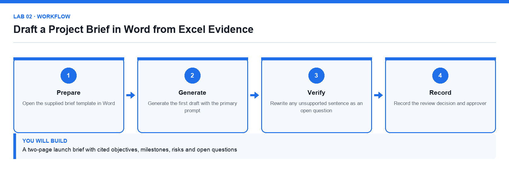

*Figure 2. Lab 02 workflow — the four stages and the artifact produced.*

**Before you begin**

- Open the lab folder labs/lab-02-draft-a-project-brief-in-word-from-excel-evidence.
- Open the lab workbook and read the Scenario sheet.
- Have the printable instruction PDF open or to hand.
- Confirm the file Lumina-Living-Lab-02.xlsx is present — Brief data and evidence register workbook.
- Confirm the file Lumina-Living-Project-Brief-Template.docx is present — Word brief template with the agreed headings.

**Primary prompt**

> Draft a two-page project brief for the Sustainable Workspace campaign using the attached template and workbook. Include purpose, three measurable objectives, scope, milestones, budget, risks and open questions. Use only figures that appear in the workbook and mark anything uncertain as an open question.

**Detailed procedure**

1. **Open the supplied brief template in Word**  
   Keep the template headings; they are the agreed structure for a Lumina Living brief.
2. **Reference the workbook as the evidence source**  
   Use Copilot's reference-a-file option so the draft is grounded in the supplied numbers rather than invented ones.
3. **Generate the first draft with the primary prompt**  
   Copilot drafts into the template structure. Treat the output as a proposal, not a finished document.
4. **Check every number against the workbook**  
   Open the Brief_Data sheet and confirm each figure. Record the sheet and cell range for each one in Evidence_Register.
5. **Rewrite any unsupported sentence as an open question**  
   A claim with no source does not become a fact by being well written; move it to the Open Questions section.
6. **Tighten the tone for a leadership audience**  
   Ask Copilot to make the brief concise and decision-focused while keeping every cited figure unchanged.
7. **Record the review decision and approver**  
   Complete Acceptance_Check so the brief has a named reviewer before it is circulated.

**Acceptance test**

The brief fills every template heading, all figures trace to the workbook, and unsupported statements appear as open questions rather than claims.

**Evidence to retain**

- Completed brief, workbook with Evidence_Register, and the named review decision.
- Your completed workbook, including the Prompt_Log and Evidence_Register sheets.
- A credential-safe screenshot — never capture passwords or personal data.

---

### Lab 03 — Refine a Responsible Copilot Use Policy in Word

Alignment: K1 · A2.  Level: Intermediate.  Apps: Word, Excel, Copilot.

Objective: Use Copilot to review, improve and simplify an existing governance document.

Goal: The learner reviews a draft internal policy with Copilot, identifies gaps and ambiguities, rewrites the weak clauses, and produces a one-page staff quick-reference from the approved text.

**What you will build**

An approved policy draft, an issue log and a staff quick-reference checklist

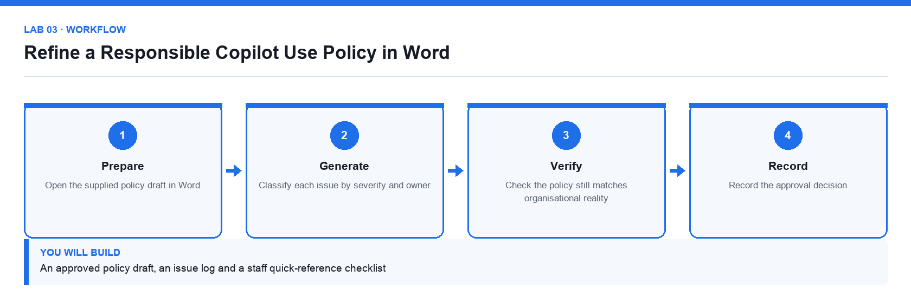

*Figure 3. Lab 03 workflow — the four stages and the artifact produced.*

**Before you begin**

- Open the lab folder labs/lab-03-refine-a-responsible-copilot-use-policy-in-word.
- Open the lab workbook and read the Scenario sheet.
- Have the printable instruction PDF open or to hand.
- Confirm the file Lumina-Living-Lab-03.xlsx is present — Issue log and acceptance workbook.
- Confirm the file Responsible-Copilot-Use-Policy-Draft.docx is present — Draft policy to be reviewed.

**Primary prompt**

> Review the attached Responsible Copilot Use Policy. Identify unclear obligations, missing controls and any clause that a staff member could not act on. For each issue give the clause, the problem and a suggested rewrite. Do not add controls the organisation has not stated.

**Detailed procedure**

1. **Open the supplied policy draft in Word**  
   Read it once yourself before asking Copilot; you need your own view to judge the suggestions.
2. **Ask Copilot to critique the policy against the primary prompt**  
   Copilot returns issues with suggested rewrites. Log each one in the Issue_Log sheet.
3. **Classify each issue by severity and owner**  
   Not every suggestion should be accepted; record Accept, Amend or Reject with a reason.
4. **Rewrite the accepted clauses in place**  
   Ask Copilot to rewrite only the clauses you accepted, keeping the defined terms unchanged.
5. **Check the policy still matches organisational reality**  
   A policy that promises a control the organisation does not operate is worse than no policy.
6. **Generate a one-page staff quick-reference**  
   Ask Copilot to summarise the approved policy as a short do/do-not checklist in plain English.
7. **Record the approval decision**  
   Complete Acceptance_Check with the reviewer and the date of approval.

**Acceptance test**

Every logged issue has a decision and a rationale, the rewritten policy keeps its defined terms, and the quick-reference matches the approved text.

**Evidence to retain**

- Revised policy, issue log with decisions, and the staff quick-reference.
- Your completed workbook, including the Prompt_Log and Evidence_Register sheets.
- A credential-safe screenshot — never capture passwords or personal data.

---

### Lab 04 — Build a PowerPoint Story from Word and Excel

Alignment: K2 · A2.  Level: Intermediate.  Apps: PowerPoint, Word, Excel, Copilot.

Objective: Convert an approved brief and supporting data into a decision-led presentation.

Goal: The learner generates a leadership deck from the approved brief and workbook, checks every claim against its source, and ends the deck with a specific decision request.

**What you will build**

An eight-slide leadership deck with one message per slide and a documented evidence map

*Figure 4. Lab 04 workflow — the four stages and the artifact produced.*

**Before you begin**

- Open the lab folder labs/lab-04-build-a-powerpoint-story-from-word-and-excel.
- Open the lab workbook and read the Scenario sheet.
- Have the printable instruction PDF open or to hand.
- Confirm the file Lumina-Living-Lab-04.xlsx is present — Presentation data and evidence map workbook.
- Confirm the file Lumina-Living-Approved-Project-Brief.docx is present — The approved brief from Lab 02.
- Confirm the file Lumina-Living-Blank-Leadership-Deck.pptx is present — Branded blank 16:9 deck.

**Primary prompt**

> Create an eight-slide leadership presentation for the Sustainable Workspace campaign using the attached project brief and workbook. Build a decision-led story: context, customer need, campaign idea, target audience, timeline, budget, risks and approval request. Use concise slide titles that state the takeaway. Do not invent numbers.

**Detailed procedure**

1. **Review the brief and the presentation data**  
   Complete the Evidence_Map before generating slides so you know what each slide must prove.
2. **Open the supplied blank deck and confirm the 16:9 layout**  
   Retain the Lumina Living theme and footer so the deck matches house branding.
3. **Create the outline with Copilot**  
   Generate the outline first and review it before slides are built; fixing a story at outline stage is far cheaper.
4. **Check that every slide earns its place**  
   Each slide must answer why it matters or what decision is needed, or it should be cut.
5. **Generate the presentation and replace generic imagery**  
   Swap stock imagery for editable shapes or approved visuals; never use a decorative chart.
6. **Verify every number against the workbook**  
   Record slide number, source sheet and cell range in Evidence_Map for each quantitative claim.
7. **Run an accessibility and legibility check**  
   Check title size, colour contrast, alt text and reading order before the deck is shared.

**Acceptance test**

The deck contains eight coherent slides, all quantitative claims trace to the workbook, and the final slide asks for a specific decision.

**Evidence to retain**

- Completed deck, workbook with Evidence_Map, and a credential-safe screenshot.
- Your completed workbook, including the Prompt_Log and Evidence_Register sheets.
- A credential-safe screenshot — never capture passwords or personal data.

---

### Lab 05 — Enhance PowerPoint with Native Charts and Speaker Notes

Alignment: K2 · A2.  Level: Intermediate.  Apps: PowerPoint, Excel, Copilot.

Objective: Turn a draft deck into a presentation-ready story with verifiable native charts.

Goal: The learner replaces picture-charts with native editable PowerPoint charts driven by the workbook, then generates and verifies speaker notes that match what each chart actually shows.

**What you will build**

A polished deck with native trend, contribution and variance charts plus verified speaker notes

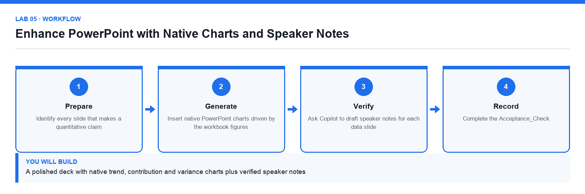

*Figure 5. Lab 05 workflow — the four stages and the artifact produced.*

**Before you begin**

- Open the lab folder labs/lab-05-enhance-powerpoint-with-native-charts-and-speaker-notes.
- Open the lab workbook and read the Scenario sheet.
- Have the printable instruction PDF open or to hand.
- Confirm the file Lumina-Living-Lab-05.xlsx is present — Chart plan and source data workbook.
- Confirm the file Lumina-Living-Leadership-Deck-Draft.pptx is present — Draft deck to be enhanced.

**Primary prompt**

> Review this deck against the attached workbook. For each data slide, tell me which chart type communicates the message most honestly, what the axis and units should be, and what a presenter should say. Flag any chart whose visual impression overstates the underlying numbers.

**Detailed procedure**

1. **Identify every slide that makes a quantitative claim**  
   List them in Chart_Plan with the message each slide is meant to deliver.
2. **Choose the honest chart type for each message**  
   Trend over time is a line; contribution is a bar or stacked bar; variance against target is a clustered bar.
3. **Insert native PowerPoint charts driven by the workbook figures**  
   A native chart keeps its data editable and auditable; a pasted image cannot be checked.
4. **Label axes, units and the source on every chart**  
   An unlabelled axis is where a misleading chart hides.
5. **Ask Copilot to draft speaker notes for each data slide**  
   Then verify each note against the chart; a note that overstates the data is a defect.
6. **Check for visual exaggeration**  
   Confirm that no axis is truncated in a way that overstates a difference.
7. **Complete the Acceptance_Check**  
   Every chart must be native, labelled, sourced and consistent with its speaker note.

**Acceptance test**

Every data slide carries a native, labelled chart traceable to the workbook, and each speaker note states only what its chart actually shows.

**Evidence to retain**

- Enhanced deck, workbook with Chart_Plan, and the verified speaker notes.
- Your completed workbook, including the Prompt_Log and Evidence_Register sheets.
- A credential-safe screenshot — never capture passwords or personal data.

---

## Topic 02 — Copilot for Excel and Outlook: Analysis and Communication

Analysis-ready data · formulas · diagnostics · forecasting · inbox triage · controlled replies  ·  Day 2

**Key concepts**

- Copilot analyses an Excel Table with one header row, one record per row and consistent data types.
- Analysis progresses from descriptive to diagnostic, then predictive and prescriptive questions.
- A suggested formula is a proposal: check its logic, references and edge cases before you accept it.
- Scenario modelling separates assumptions from formulas so base, downside and upside cases can be compared.
- Outlook Copilot triages a mailbox, summarises a thread and drafts a reply, but a person always sends it.
- Every quantitative claim must trace back to a named sheet and cell range before it is used in a decision.

### Lab 06 — Build and Audit Excel Formulas with Copilot

Alignment: K2 · A2.  Level: Foundation.  Apps: Excel, Copilot.

Objective: Generate derived columns with Copilot and audit every formula before accepting it.

Goal: The learner converts a flat range into an Excel Table, asks Copilot to add derived margin, conversion and status columns, then audits each generated formula against the assumptions sheet.

**What you will build**

A formula-driven campaign table with revenue, margin, conversion, status and error controls

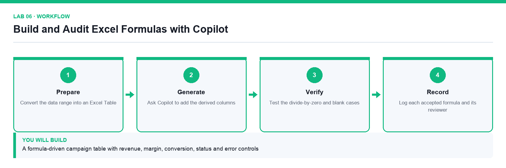

*Figure 6. Lab 06 workflow — the four stages and the artifact produced.*

**Before you begin**

- Open the lab folder labs/lab-06-build-and-audit-excel-formulas-with-copilot.
- Open the lab workbook and read the Scenario sheet.
- Have the printable instruction PDF open or to hand.
- Confirm the file Lumina-Living-Lab-06.xlsx is present — Campaign data, assumptions and controls workbook.

**Primary prompt**

> In the Campaign_Data table add calculated columns for Margin, Margin_Percent, Conversion_Rate, Return_Rate and Target_Status. Use the thresholds in the Assumptions sheet, use structured references, and handle divide-by-zero safely. Explain each formula you add.

**Detailed procedure**

1. **Convert the data range into an Excel Table**  
   Copilot analyses a Table far more reliably than a loose range, and structured references survive inserted rows.
2. **Confirm the data is analysis-ready**  
   One header row, one record per row, consistent types and no merged cells.
3. **Ask Copilot to add the derived columns**  
   Use the primary prompt so the thresholds come from Assumptions rather than being hard-coded.
4. **Audit every generated formula**  
   Read each formula and confirm its logic, its references and its rounding before you accept it.
5. **Test the divide-by-zero and blank cases**  
   A record with zero clicks or zero impressions must not produce an error value.
6. **Verify the control totals**  
   Complete the Controls sheet: record count, blank keys and negative revenue must all match the expected values.
7. **Log each accepted formula and its reviewer**  
   Record the formula, what it computes and who checked it in the Formula_Audit sheet.

**Acceptance test**

Every derived column uses a checked structured-reference formula, no error values remain, and the Controls sheet matches the expected record count and zero exceptions.

**Evidence to retain**

- Completed workbook with Formula_Audit, Controls and Acceptance_Check.
- Your completed workbook, including the Prompt_Log and Evidence_Register sheets.
- A credential-safe screenshot — never capture passwords or personal data.

---

### Lab 07 — Run Deep Descriptive and Diagnostic Analysis in Excel

Alignment: K2 · A2.  Level: Intermediate.  Apps: Excel, Copilot.

Objective: Move from what happened to why it happened, with each finding traced to evidence.

Goal: The learner uses Copilot to summarise performance, segment it by region, channel and product, isolate anomalies, and write management findings that each cite the cells they came from.

**What you will build**

A diagnostic workbook with a KPI summary, segment analysis, an anomaly log and management findings

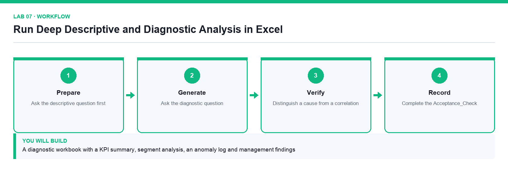

*Figure 7. Lab 07 workflow — the four stages and the artifact produced.*

**Before you begin**

- Open the lab folder labs/lab-07-run-deep-descriptive-and-diagnostic-analysis-in-excel.
- Open the lab workbook and read the Scenario sheet.
- Have the printable instruction PDF open or to hand.
- Confirm the file Lumina-Living-Lab-07.xlsx is present — Campaign data, KPI summary and anomaly log workbook.

**Primary prompt**

> Analyse the Campaign_Data table. Give me a KPI summary, then break performance down by Region, Channel and Product. Identify the three largest drivers of the gap against Target_Revenue and list any records that look anomalous, with the reason. Cite the columns you used.

**Detailed procedure**

1. **Ask the descriptive question first**  
   Establish what happened — totals, averages and trend — before asking why.
2. **Segment the results**  
   Break the totals down by Region, Channel and Product to find where the variance actually sits.
3. **Ask the diagnostic question**  
   Ask Copilot which segments drive the gap against target and what evidence supports that.
4. **Isolate anomalies and record them**  
   Log each anomalous record in Anomaly_Log with the reason it was flagged.
5. **Distinguish a cause from a correlation**  
   A segment that moves with the gap is not automatically its cause; note what further evidence would be needed.
6. **Write management findings with citations**  
   Each finding states the observation, the evidence cells and the recommended action.
7. **Complete the Acceptance_Check**  
   Every finding must cite the sheet and range it came from.

**Acceptance test**

The workbook holds a KPI summary, a segment breakdown, a populated anomaly log, and findings that each cite the sheet and range supporting them.

**Evidence to retain**

- Completed diagnostic workbook and the management findings sheet.
- Your completed workbook, including the Prompt_Log and Evidence_Register sheets.
- A credential-safe screenshot — never capture passwords or personal data.

---

### Lab 08 — Forecast and Stress-Test a Campaign with Copilot

Alignment: K2 · A2.  Level: Advanced.  Apps: Excel, Copilot.

Objective: Build a scenario model that separates assumptions from formulas and states its own limits.

Goal: The learner builds base, downside and upside forecasts from the historical data, runs a sensitivity table across the key drivers, and records the guardrails that say when the forecast should not be trusted.

**What you will build**

A forecast model with base, downside and upside scenarios, a sensitivity table and decision guardrails

*Figure 8. Lab 08 workflow — the four stages and the artifact produced.*

**Before you begin**

- Open the lab folder labs/lab-08-forecast-and-stress-test-a-campaign-with-copilot.
- Open the lab workbook and read the Scenario sheet.
- Have the printable instruction PDF open or to hand.
- Confirm the file Lumina-Living-Lab-08.xlsx is present — Historical data, assumptions and scenario workbook.

**Primary prompt**

> Using the historical Campaign_Data, build a six-month revenue forecast with base, downside and upside scenarios. Keep every assumption in the Assumptions sheet and reference it from the formulas. State the method you used and the conditions under which the forecast would not hold.

**Detailed procedure**

1. **Separate assumptions from formulas**  
   Every growth rate, conversion rate and cost factor lives in Assumptions and is referenced, never typed into a formula.
2. **Build the base case**  
   Ask Copilot for the method as well as the numbers so the model can be explained to a reviewer.
3. **Add the downside and upside scenarios**  
   Change only the assumption cells; if a scenario needs a formula change, the model is not built correctly.
4. **Build a sensitivity table across the two strongest drivers**  
   Show how the outcome moves as each driver varies, so the reader sees the range rather than a single number.
5. **State the forecast's limits explicitly**  
   Record the conditions under which this forecast should not be used for a decision.
6. **Record the decision guardrails**  
   Define the thresholds at which the campaign would be paused, reviewed or escalated.
7. **Complete the Acceptance_Check**  
   A reviewer must be able to change one assumption and see every scenario update.

**Acceptance test**

Changing a single assumption cell updates all three scenarios and the sensitivity table, and the workbook states the conditions under which the forecast does not hold.

**Evidence to retain**

- Forecast workbook with the scenario, sensitivity and guardrail sheets.
- Your completed workbook, including the Prompt_Log and Evidence_Register sheets.
- A credential-safe screenshot — never capture passwords or personal data.

---

### Lab 09 — Triage an Outlook Inbox and Draft a Controlled Reply

Alignment: K2 · A2.  Level: Intermediate.  Apps: Outlook, Excel, Copilot.

Objective: Use Copilot to triage and summarise mail, then draft a reply that a person approves before sending.

Goal: The learner triages a supplied mail pack, summarises a long thread, verifies the summary against the original messages, and drafts one reply that is explicitly approved before it would be sent.

**What you will build**

An inbox triage register, a verified thread summary and one approval-ready draft reply

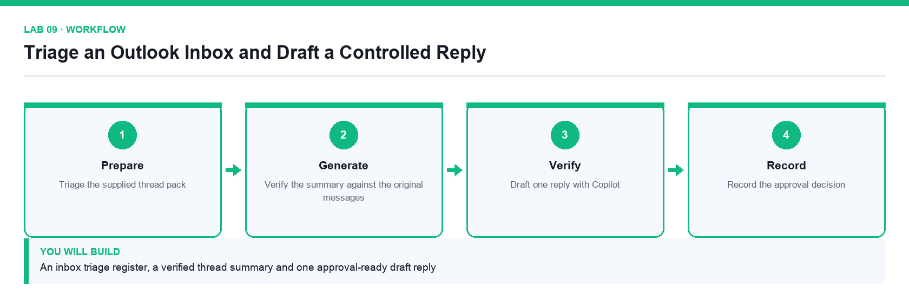

*Figure 9. Lab 09 workflow — the four stages and the artifact produced.*

**Before you begin**

- Open the lab folder labs/lab-09-triage-an-outlook-inbox-and-draft-a-controlled-reply.
- Open the lab workbook and read the Scenario sheet.
- Have the printable instruction PDF open or to hand.
- Confirm the file Lumina-Living-Lab-09.xlsx is present — Triage register and evidence workbook.
- Confirm the file Outlook-Thread-Pack.docx is present — The supplied email thread pack.

**Primary prompt**

> Summarise this email thread. List the decisions already made, the open questions, who owns each action and the dates committed. Flag anything where the thread contradicts itself. Do not infer agreement that was not stated.

**Detailed procedure**

1. **Triage the supplied thread pack**  
   Classify each message as Action, Awaiting, Information or Archive in the Triage_Register.
2. **Summarise the longest thread with Copilot**  
   Use the primary prompt so the summary separates decisions from open questions.
3. **Verify the summary against the original messages**  
   Check each stated decision actually appears in the thread; a plausible summary is not a correct one.
4. **Record any contradiction the thread contains**  
   Where two messages disagree, the summary must surface the conflict rather than resolve it silently.
5. **Draft one reply with Copilot**  
   Set the tone and length explicitly, and state the facts the reply is allowed to assert.
6. **Verify recipients, facts and attachments**  
   The human-send gate: check who is on the To and Cc lines before anything is sent.
7. **Record the approval decision**  
   Log the reviewer and the decision in Acceptance_Check. The draft is not sent during the lab.

**Acceptance test**

The triage register classifies every message, the thread summary matches the original messages, and the draft reply carries a named approver before any send.

**Evidence to retain**

- Triage register, verified summary and the approved draft reply.
- Your completed workbook, including the Prompt_Log and Evidence_Register sheets.
- A credential-safe screenshot — never capture passwords or personal data.

---

### Lab 10 — Turn Meeting Notes into an Action Register

Alignment: K2 · A2.  Level: Intermediate.  Apps: Teams, Word, Excel, Copilot.

Objective: Convert an unstructured meeting record into owned, dated and verifiable actions.

Goal: The learner turns a supplied meeting-notes document into a decision log and an action register with named owners and due dates, then verifies every action against the source notes.

**What you will build**

A meeting brief, a decision log, an action register and a reviewed follow-up message

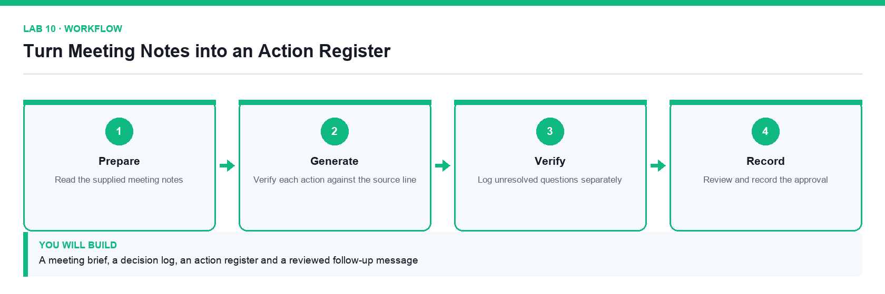

*Figure 10. Lab 10 workflow — the four stages and the artifact produced.*

**Before you begin**

- Open the lab folder labs/lab-10-turn-meeting-notes-into-an-action-register.
- Open the lab workbook and read the Scenario sheet.
- Have the printable instruction PDF open or to hand.
- Confirm the file Lumina-Living-Lab-10.xlsx is present — Decision log and action register workbook.
- Confirm the file Teams-Meeting-Notes.docx is present — The supplied meeting notes.

**Primary prompt**

> From these meeting notes produce three things: a list of decisions made, a list of actions with an owner and a due date for each, and a list of unresolved questions. Quote the line that supports each decision. Do not create an action that nobody agreed to.

**Detailed procedure**

1. **Read the supplied meeting notes**  
   Form your own view of what was decided before Copilot summarises it for you.
2. **Extract decisions, actions and open questions**  
   Use the primary prompt so each of the three lists is separated.
3. **Verify each action against the source line**  
   An action with no supporting line in the notes is an invention and must be removed.
4. **Assign an owner and a due date to every action**  
   An action without a named owner and a date will not happen.
5. **Log unresolved questions separately**  
   Open questions are not actions; conflating them hides the fact that a decision is still needed.
6. **Draft the follow-up message**  
   Ask Copilot for a short message summarising decisions and actions for the attendees.
7. **Review and record the approval**  
   Confirm every action and owner is correct, then log the reviewer in Acceptance_Check.

**Acceptance test**

Every action in the register cites a supporting line from the notes and carries a named owner and due date, and unresolved questions are listed separately from actions.

**Evidence to retain**

- Decision log, action register and the reviewed follow-up message.
- Your completed workbook, including the Prompt_Log and Evidence_Register sheets.
- A credential-safe screenshot — never capture passwords or personal data.

---

## Topic 03 — Business Process Automation with Power Automate

BPA · the Power Platform · triggers · actions · dynamic content · conditions · approvals  ·  Day 3

**Key concepts**

- Business process automation replaces repeated manual handovers with a reliable, auditable flow.
- Every flow is Trigger then Actions then Output: something happens, steps run, a result is produced.
- The four trigger families are automated, instant, scheduled and business-process triggers.
- Dynamic content passes data from one step to the next; the run history shows exactly what each step received.
- A condition branches a flow so different inputs follow different paths.
- An approval action suspends the run until a named person responds, which is human-in-the-loop by design.

### Lab 11 — Prepare the Power Platform Environment

Alignment: K3 · A1.  Level: Foundation.  Apps: Power Platform admin centre, Power Automate.

Objective: Identify the environment that holds your automation and confirm the connections it needs.

Goal: The learner selects the correct Power Platform environment, confirms the connectors and connections the course needs, and records the environment details that every later lab depends on.

**What you will build**

A verified working environment with the Forms, Outlook, Excel, Approvals and SharePoint connections in place

*Figure 11. Lab 11 workflow — the four stages and the artifact produced.*

**Before you begin**

- Open the lab folder labs/lab-11-prepare-the-power-platform-environment.
- Open the lab workbook and read the Scenario sheet.
- Have the printable instruction PDF open or to hand.
- Confirm the file Lumina-Living-Lab-11.xlsx is present — Environment and connection verification workbook.

**Primary prompt**

> List the Power Platform environments I can use, and for each tell me its type, its region and whether it has a Dataverse database. Explain which one I should build a training flow in and why.

**Detailed procedure**

1. **Open the Power Platform admin centre**  
   Go to admin.powerplatform.microsoft.com and sign in with the course account. The environment is the container that holds every flow, agent and connection you create.
2. **Identify the environment you will use**  
   Note its name, type and region in the Environment sheet. Building in the wrong environment is the single most common cause of a lab that cannot be found later.
3. **Open Power Automate and select that environment**  
   Go to make.powerautomate.com and set the environment selector in the top-right corner. Check it before every lab.
4. **Review the existing connections**  
   Under Connections, confirm which of Microsoft Forms, Office 365 Outlook, Excel Online (Business), Approvals and SharePoint are already connected.
5. **Create any missing connection**  
   Add a connection for each missing connector and sign in with the course account when prompted.
6. **Confirm your mailbox is reachable**  
   Send yourself a test message so you know the Outlook connection works before a flow depends on it.
7. **Record the environment details**  
   Complete the Environment sheet with the environment name, region and the connections verified, and note the date.

**Acceptance test**

The environment selector shows the recorded environment, and every connector needed by the course appears under Connections with a working status.

**Evidence to retain**

- Completed environment workbook and a credential-safe screenshot of the connections list.
- Your completed workbook, including the Prompt_Log and Evidence_Register sheets.
- A credential-safe screenshot — never capture passwords or personal data.

---

### Lab 12 — Build a Trigger and Actions Flow from Microsoft Forms

Alignment: K3 · A3.  Level: Foundation.  Apps: Power Automate, Microsoft Forms, Outlook.

Objective: Build an automated cloud flow that reacts to an event and sends a personalised response.

Goal: The learner creates a Microsoft Form, builds an automated cloud flow that starts on submission, retrieves the answers and sends a personalised confirmation to the address the requester entered.

**What you will build**

A working Forms-to-email flow that acknowledges every enquiry automatically

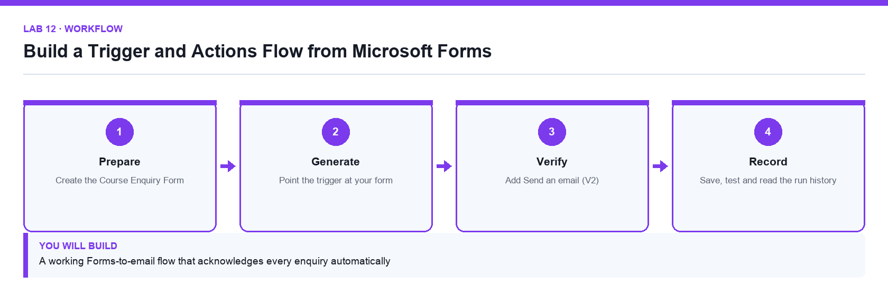

*Figure 12. Lab 12 workflow — the four stages and the artifact produced.*

**Before you begin**

- Open the lab folder labs/lab-12-build-a-trigger-and-actions-flow-from-microsoft-forms.
- Open the lab workbook and read the Scenario sheet.
- Have the printable instruction PDF open or to hand.
- Confirm the file Lumina-Living-Lab-12.xlsx is present — Flow design and run-verification workbook.

**Primary prompt**

> Describe the trigger and actions I need so that when someone submits a Microsoft Form, the person who submitted it receives a personalised confirmation email. Name the exact connector actions and explain why the response details step is needed.

**Detailed procedure**

1. **Create the Course Enquiry Form**  
   At forms.office.com create a form named Course Enquiry Form with four required Text questions: Name, Email, Tel and Message, with Long answer enabled on Message.
2. **Create an automated cloud flow**  
   At make.powerautomate.com choose Create, then Automated cloud flow, name it Lab 12 - Form Email Confirmation, and pick the Microsoft Forms trigger When a new response is submitted.
3. **Point the trigger at your form**  
   Set Form Id to Course Enquiry Form. The trigger fires once per submission and carries only a Response Id, not the answers.
4. **Add Get response details**  
   Add the Microsoft Forms action Get response details, set Form Id again, and set Response Id from dynamic content under the trigger. This is the step that actually fetches the answers.
5. **Add Send an email (V2)**  
   Add the Office 365 Outlook action Send an email (V2). Set the To field from the form's Email answer using dynamic content, never by typing a value.
6. **Compose a personalised body**  
   Insert the Name answer into the subject and body so the reply is addressed to the requester. A dynamic value must be inserted from the panel, never typed as text.
7. **Save, test and read the run history**  
   Save the flow, submit the form once, then open the run history and confirm each step shows a green tick and the Outlook step shows the submitted address.

**Acceptance test**

One form submission produces one successful run, and the confirmation email arrives at the address entered in the form rather than the flow owner's mailbox.

**Evidence to retain**

- Flow run-history screenshot showing a successful run and the delivered confirmation email.
- Your completed workbook, including the Prompt_Log and Evidence_Register sheets.
- A credential-safe screenshot — never capture passwords or personal data.

---

### Lab 13 — Log Form Submissions to Excel Online

Alignment: K3 · A3.  Level: Intermediate.  Apps: Power Automate, Microsoft Forms, Excel Online, OneDrive.

Objective: Integrate a flow with a second system so every submission is recorded as a row of data.

Goal: The learner extends the enquiry flow so each submission also writes a row into a named Excel table, producing an auditable log alongside the email acknowledgement.

**What you will build**

An enquiry flow that both emails the requester and appends a row to an Excel log table

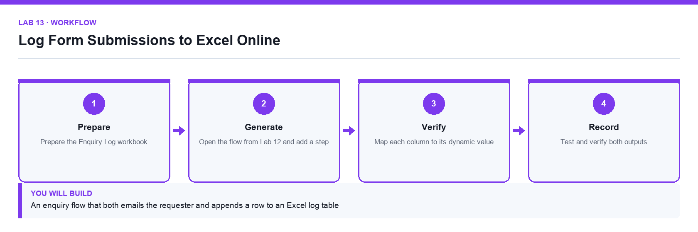

*Figure 13. Lab 13 workflow — the four stages and the artifact produced.*

**Before you begin**

- Open the lab folder labs/lab-13-log-form-submissions-to-excel-online.
- Open the lab workbook and read the Scenario sheet.
- Have the printable instruction PDF open or to hand.
- Confirm the file Lumina-Living-Lab-13.xlsx is present — Flow design and verification workbook.
- Confirm the file Enquiry-Log.xlsx is present — Workbook containing the formatted EnquiryLog table.

**Primary prompt**

> I want every Microsoft Forms submission to be appended as a row in an Excel table stored in OneDrive. Tell me what the workbook must contain before the action will work, and what each field of the Add a row into a table action needs.

**Detailed procedure**

1. **Prepare the Enquiry Log workbook**  
   Upload the supplied Enquiry Log.xlsx to OneDrive for Business. It already contains a formatted table named EnquiryLog with the columns Timestamp, Name, Email, Tel and Message.
2. **Understand why a named table is required**  
   The Excel Online connector can only write into a formatted table, not a plain sheet range. A worksheet without a table will not appear in the Table dropdown.
3. **Open the flow from Lab 12 and add a step**  
   Add a new action after Get response details so both the log row and the email use the same retrieved answers.
4. **Add Add a row into a table**  
   Choose the Excel Online (Business) action Add a row into a table. Set Location to OneDrive for Business, Document Library to OneDrive, File to Enquiry Log.xlsx and Table to EnquiryLog.
5. **Map each column to its dynamic value**  
   Map Name, Email, Tel and Message from Get response details. For Timestamp use the expression utcNow() entered in the expression tab.
6. **Order the steps deliberately**  
   Write the log row before sending the email so a delivery failure still leaves an auditable record of the enquiry.
7. **Test and verify both outputs**  
   Submit the form, then confirm the run succeeded, a new row appeared in EnquiryLog and the confirmation email arrived.

**Acceptance test**

A single form submission produces one new row in the EnquiryLog table with all five columns populated, and one confirmation email.

**Evidence to retain**

- The updated Excel log showing the new row, plus the successful run history.
- Your completed workbook, including the Prompt_Log and Evidence_Register sheets.
- A credential-safe screenshot — never capture passwords or personal data.

---

### Lab 14 — Branch a Flow with a Condition

Alignment: K3 · A3.  Level: Intermediate.  Apps: Power Automate, Microsoft Forms, Outlook.

Objective: Route a process down different paths according to the data it receives.

Goal: The learner adds a condition so that enquiries are handled differently according to their content, sending an urgent notification down one branch and a standard acknowledgement down the other.

**What you will build**

A branching flow whose two paths are both proven by a test submission

*Figure 14. Lab 14 workflow — the four stages and the artifact produced.*

**Before you begin**

- Open the lab folder labs/lab-14-branch-a-flow-with-a-condition.
- Open the lab workbook and read the Scenario sheet.
- Have the printable instruction PDF open or to hand.
- Confirm the file Lumina-Living-Lab-14.xlsx is present — Branch design and test-evidence workbook.

**Primary prompt**

> Explain how a Condition action works in Power Automate, what the If yes and If no branches do, and how I should test a flow that branches so I know both paths work.

**Detailed procedure**

1. **Decide the branching rule**  
   Define the business rule first: an enquiry mentioning a named urgent keyword is escalated, everything else receives the standard acknowledgement.
2. **Add a Condition action**  
   Insert a Condition after Get response details. A condition evaluates to true or false and creates the If yes and If no branches.
3. **Configure the condition test**  
   Set the left side from the Message dynamic value, choose the contains operator, and enter the keyword on the right side.
4. **Build the If yes branch**  
   Add a Send an email (V2) action that notifies the team mailbox with the enquiry details and an Urgent subject line.
5. **Build the If no branch**  
   Move the standard confirmation email into the If no branch so exactly one acknowledgement is sent per submission.
6. **Test both paths deliberately**  
   Submit once with the keyword and once without. A branch that has never run is a branch you have not tested.
7. **Read the run history for each path**  
   Open both runs and confirm which branch executed. Skipped actions appear greyed out, which is not the same as a failure.

**Acceptance test**

Two submissions produce two successful runs that each take a different branch, and the run history shows the untaken branch as skipped rather than failed.

**Evidence to retain**

- Run histories for both branches and the two resulting emails.
- Your completed workbook, including the Prompt_Log and Evidence_Register sheets.
- A credential-safe screenshot — never capture passwords or personal data.

---

### Lab 15 — Suspend a Flow for a Human Approval

Alignment: K5 · A7.  Level: Advanced.  Apps: Power Automate, Approvals, Outlook, Teams.

Objective: Insert a human decision into an automated process so a consequential action needs a person.

Goal: The learner builds a leave-application flow that pauses at an approval action, waits for a named approver's decision, and then takes a different action for an approved and a rejected outcome.

**What you will build**

A leave-application flow that suspends until an approver responds and records the outcome

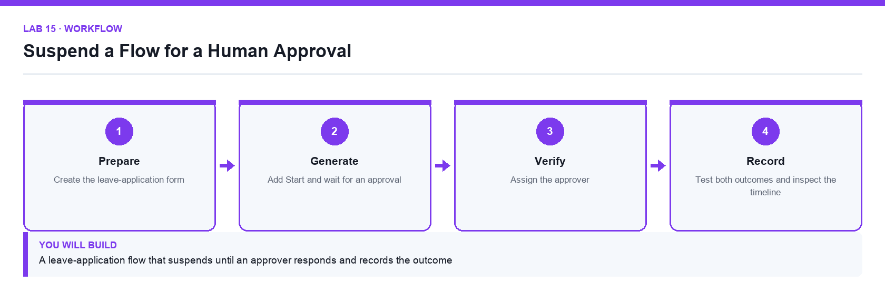

*Figure 15. Lab 15 workflow — the four stages and the artifact produced.*

**Before you begin**

- Open the lab folder labs/lab-15-suspend-a-flow-for-a-human-approval.
- Open the lab workbook and read the Scenario sheet.
- Have the printable instruction PDF open or to hand.
- Confirm the file Lumina-Living-Lab-15.xlsx is present — Approval design and outcome-evidence workbook.

**Primary prompt**

> Explain what happens to a Power Automate run when it reaches a Start and wait for an approval action, how long it can wait, and how I should handle the approved and rejected outcomes.

**Detailed procedure**

1. **Create the leave-application form**  
   Build a form capturing the applicant's name, email, leave type, start date, end date and reason.
2. **Create the flow and retrieve the answers**  
   Use the Forms trigger and Get response details exactly as in Lab 12, so the approval has real data to show.
3. **Add Start and wait for an approval**  
   Choose the Approvals action Start and wait for an approval, with Approval type Approve/Reject - First to respond. The run genuinely suspends here; it is not polling.
4. **Write a title and details the approver can act on**  
   Insert the applicant name, dates and reason into the Details field so the approver does not have to look anything up.
5. **Assign the approver**  
   Set Assigned To to the approver's address. Only a named person can respond, and their decision is recorded against them.
6. **Branch on the outcome**  
   Add a Condition testing whether the Outcome dynamic value equals Approve, then send the applicant a confirmation on the If yes branch and a rejection with the approver's comments on the If no branch.
7. **Test both outcomes and inspect the timeline**  
   Run it twice, approving once and rejecting once, then read the run history to see how long the run stayed suspended and when it resumed.

**Acceptance test**

The run remains in a waiting state until the approver responds, then resumes down the branch matching the decision and emails the applicant the correct outcome.

**Evidence to retain**

- Run histories for an approved and a rejected application, plus the two resulting emails.
- Your completed workbook, including the Prompt_Log and Evidence_Register sheets.
- A credential-safe screenshot — never capture passwords or personal data.

---

## Topic 04 — Designing and Building Copilot Studio Agents

Workflow vs agent · instructions · knowledge · tools · skills · connected agents · publishing  ·  Day 4

**Key concepts**

- A workflow follows a fixed path; an agent decides which step to take next from its instructions.
- An agent is made of instructions, knowledge, tools, skills and connected agents.
- Instructions shape behaviour but are not enforced; tools, schemas and approvals are what actually enforce limits.
- Grounding an agent in approved knowledge is what makes its answers citable and its refusals correct.
- A tool lets an agent act on a system; a connected agent delegates a task to another specialised agent.
- Publishing to a channel such as Microsoft Teams makes the agent available to real users.

### Lab 16 — Design a Scoped Agent Before You Build It

Alignment: K4 · A1.  Level: Foundation.  Apps: Copilot Studio, Excel.

Objective: Define an agent's purpose, boundaries and acceptance tests before any configuration.

Goal: The learner produces an agent design canvas that states the job the agent does, what it must refuse, the knowledge it may use, the actions it may take and the tests that will prove it behaves.

**What you will build**

An agent design canvas, a knowledge register, a risk-and-control table and ten acceptance tests

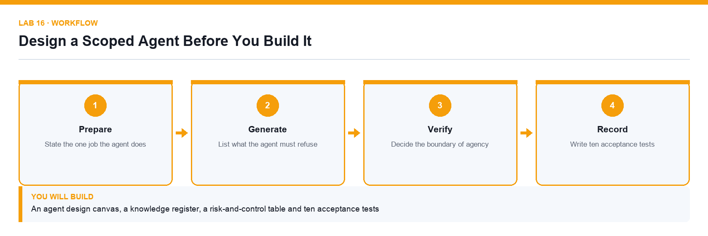

*Figure 16. Lab 16 workflow — the four stages and the artifact produced.*

**Before you begin**

- Open the lab folder labs/lab-16-design-a-scoped-agent-before-you-build-it.
- Open the lab workbook and read the Scenario sheet.
- Have the printable instruction PDF open or to hand.
- Confirm the file Lumina-Living-Lab-16.xlsx is present — Agent design canvas, knowledge register and test workbook.
- Confirm the file Procurement-Policy.docx is present — The approved procurement policy used as knowledge.

**Primary prompt**

> Help me scope an agent that answers staff questions about our procurement policy. List the questions it should answer, the questions it must refuse, the knowledge it needs, and the actions it should never take on its own. Ask me for anything you need to know.

**Detailed procedure**

1. **State the one job the agent does**  
   An agent with one clear job can be tested; an agent that does everything can only be hoped for. Write it as a single sentence in the Design_Canvas sheet.
2. **Separate a workflow from an agent**  
   If the path is always the same, build a flow. Choose an agent only when the next step genuinely depends on what the user says.
3. **List what the agent must refuse**  
   Write the out-of-scope questions explicitly. An agent with no stated refusals will answer everything, including things it should not.
4. **Register the knowledge sources**  
   Record each approved source in Knowledge_Register with its owner. Note that a source you do not add is a source the agent cannot cite.
5. **Decide the boundary of agency**  
   For each candidate action, record whether the agent may do it alone, may do it with a human gate, or may never do it.
6. **Identify the risks and the control for each**  
   For every risk, name the control. A control the model cannot reach beats an instruction you asked it to follow.
7. **Write ten acceptance tests**  
   Write ten concrete test cases with the expected outcome, including at least three that must be refused.

**Acceptance test**

The canvas states one job, lists explicit refusals, registers every knowledge source with an owner, and carries ten acceptance tests of which at least three expect a refusal.

**Evidence to retain**

- Completed design canvas, knowledge register, risk-and-control table and test list.
- Your completed workbook, including the Prompt_Log and Evidence_Register sheets.
- A credential-safe screenshot — never capture passwords or personal data.

---

### Lab 17 — Build and Ground a Copilot Studio Agent

Alignment: K4 · A5.  Level: Intermediate.  Apps: Copilot Studio, SharePoint.

Objective: Create an agent, write its instructions and ground it in approved knowledge.

Goal: The learner creates an agent in Copilot Studio, writes instructions that define its role and limits, attaches the approved policy as knowledge, removes the open-web source and tests that it cites and refuses correctly.

**What you will build**

A working, grounded agent that answers from the approved policy and refuses everything else

*Figure 17. Lab 17 workflow — the four stages and the artifact produced.*

**Before you begin**

- Open the lab folder labs/lab-17-build-and-ground-a-copilot-studio-agent.
- Open the lab workbook and read the Scenario sheet.
- Have the printable instruction PDF open or to hand.
- Confirm the file Lumina-Living-Lab-17.xlsx is present — Agent build and test-results workbook.
- Confirm the file Procurement-Policy.docx is present — The approved procurement policy.

**Primary prompt**

> You are the Lumina Living procurement assistant. Answer staff questions using only the approved procurement policy. Cite the section you used. If the answer is not in the policy, say so and tell the person who to contact. Never quote a price or recommend a vendor that is not in the policy.

**Detailed procedure**

1. **Create the agent in Copilot Studio**  
   At copilotstudio.microsoft.com choose Create, then New agent, and name it Procurement Assistant. Confirm you are in the course environment.
2. **Write the instructions**  
   Paste the primary prompt into Instructions. Instructions shape behaviour but are not enforced, so keep them specific and testable.
3. **Attach the approved policy as knowledge**  
   Under Knowledge, add the supplied procurement policy. Only an attached source can be cited.
4. **Remove the Search all websites source**  
   This source is on by default. Remove it before the first test or the agent will answer procurement questions from the open web.
5. **Test an in-scope question**  
   Ask a question the policy answers and confirm the reply cites the policy section rather than paraphrasing from memory.
6. **Test an out-of-scope question**  
   Ask something the policy does not cover and confirm the agent refuses and redirects, rather than inventing an answer.
7. **Run the full acceptance test set**  
   Work through the ten tests from Lab 16 and record the actual result against the expected one for each.

**Acceptance test**

The agent cites the policy for in-scope questions, refuses and redirects for out-of-scope ones, and passes every acceptance test recorded in the workbook.

**Evidence to retain**

- Agent test transcript, the completed test results and a credential-safe screenshot of the knowledge panel.
- Your completed workbook, including the Prompt_Log and Evidence_Register sheets.
- A credential-safe screenshot — never capture passwords or personal data.

---

### Lab 18 — Give an Agent a Tool and a Knowledge Source

Alignment: K4 · A5.  Level: Intermediate.  Apps: Copilot Studio, SharePoint, Power Automate.

Objective: Extend an agent so it can look up real data and act, not only answer from a document.

Goal: The learner creates a SharePoint list of approved vendors, publishes an agent flow that looks a vendor up, attaches it to the agent as a tool, and proves the agent calls it instead of guessing.

**What you will build**

An agent that answers vendor questions from a live SharePoint list through a published tool

*Figure 18. Lab 18 workflow — the four stages and the artifact produced.*

**Before you begin**

- Open the lab folder labs/lab-18-give-an-agent-a-tool-and-a-knowledge-source.
- Open the lab workbook and read the Scenario sheet.
- Have the printable instruction PDF open or to hand.
- Confirm the file Lumina-Living-Lab-18.xlsx is present — Tool design and test workbook.
- Confirm the file Approved-Vendors.csv is present — Vendor master data for the SharePoint list.

**Primary prompt**

> Look up the vendor the user names in the ApprovedVendors list and report the vendor's status and category. If the vendor is not on the list, say it is not an approved vendor. Do not guess a status and do not use any other source.

**Detailed procedure**

1. **Create the ApprovedVendors SharePoint list**  
   Import the supplied vendors.csv into a SharePoint list with columns for vendor name, category, status and review date.
2. **Build an agent flow that queries the list**  
   In Copilot Studio create a flow that takes a vendor name as input, uses the SharePoint Get items action with a filter, and returns the matching status and category.
3. **Define the flow's input and output clearly**  
   The tool's contract is what the agent understands. An ambiguous output field will be interpreted inconsistently.
4. **Publish the flow**  
   An unpublished flow cannot be attached as a tool. Publish it before returning to the agent.
5. **Attach the flow to the agent as a tool**  
   Under Tools, add the published flow and give it a description that says exactly when to use it.
6. **Write a tool description the model can act on**  
   The description is how the agent decides whether to call the tool; a vague description produces a tool that is never called or always called.
7. **Test with a listed and an unlisted vendor**  
   Confirm the agent calls the tool and reports the real status, and that an unknown vendor is reported as not approved rather than invented.

**Acceptance test**

The agent returns the correct live status for a listed vendor and reports an unlisted vendor as not approved, with the run history showing the tool was actually called.

**Evidence to retain**

- Tool call shown in the run history, plus the test transcript for both cases.
- Your completed workbook, including the Prompt_Log and Evidence_Register sheets.
- A credential-safe screenshot — never capture passwords or personal data.

---

### Lab 19 — Orchestrate Connected Agents

Alignment: K4 · A5.  Level: Advanced.  Apps: Copilot Studio, connected agents.

Objective: Delegate specialised work from one agent to another and keep the handover accountable.

Goal: The learner builds a second specialised agent and connects it to the first, so an orchestrating agent routes each request to the right specialist and reports which one answered.

**What you will build**

An orchestrating agent that routes requests to a connected specialist agent

*Figure 19. Lab 19 workflow — the four stages and the artifact produced.*

**Before you begin**

- Open the lab folder labs/lab-19-orchestrate-connected-agents.
- Open the lab workbook and read the Scenario sheet.
- Have the printable instruction PDF open or to hand.
- Confirm the file Lumina-Living-Lab-19.xlsx is present — Orchestration and routing-test workbook.

**Primary prompt**

> You coordinate staff requests. If the request is about procurement policy or vendors, hand it to the Procurement Assistant. If it is about anything else, say it is out of scope and name the team to contact. Always tell the user which specialist answered.

**Detailed procedure**

1. **Create the specialist agent**  
   Build a second narrow agent for a different domain, grounded only in its own knowledge source.
2. **Create the orchestrating agent**  
   Create a third agent whose job is routing rather than answering, and paste the primary prompt into its instructions.
3. **Connect the specialists**  
   Under Connected agents, add each specialist and describe precisely what it handles.
4. **Write routing rules that do not overlap**  
   Two specialists whose descriptions overlap will be selected inconsistently; make the boundary explicit.
5. **Require the orchestrator to name its specialist**  
   Attribution is what makes a wrong answer traceable to the agent that produced it.
6. **Test each route**  
   Send one request per specialist plus one that belongs to neither, and confirm each is handled correctly.
7. **Record which agent answered each test**  
   Complete the Routing_Test sheet with the request, the expected specialist and the one that actually answered.

**Acceptance test**

Each test request reaches the correct specialist, the out-of-scope request is refused, and every reply names the agent that answered it.

**Evidence to retain**

- Routing test results and transcripts showing the attribution for each answer.
- Your completed workbook, including the Prompt_Log and Evidence_Register sheets.
- A credential-safe screenshot — never capture passwords or personal data.

---

### Lab 20 — Publish an Agent to Microsoft Teams

Alignment: K4 · A5.  Level: Advanced.  Apps: Copilot Studio, Microsoft Teams.

Objective: Release an agent to real users through a channel and confirm it behaves after publishing.

Goal: The learner publishes the grounded agent to Microsoft Teams, confirms the published version behaves as the test version did, and records the release decision and rollback plan.

**What you will build**

A published agent available in Microsoft Teams with a recorded release decision

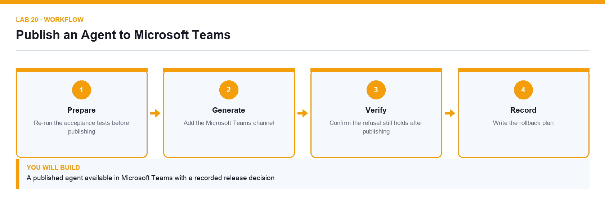

*Figure 20. Lab 20 workflow — the four stages and the artifact produced.*

**Before you begin**

- Open the lab folder labs/lab-20-publish-an-agent-to-microsoft-teams.
- Open the lab workbook and read the Scenario sheet.
- Have the printable instruction PDF open or to hand.
- Confirm the file Lumina-Living-Lab-20.xlsx is present — Release log and rollback-plan workbook.

**Primary prompt**

> Summarise what changes when an agent is published to Teams: who can reach it, which version they get, what happens to my unpublished edits, and how I roll back a bad release.

**Detailed procedure**

1. **Re-run the acceptance tests before publishing**  
   Publishing a failing agent makes the failure everyone's problem. The test set from Lab 16 is the release gate.
2. **Publish the agent**  
   Use Publish in Copilot Studio. Users always receive the published version, never your latest unpublished edit.
3. **Add the Microsoft Teams channel**  
   Under Channels choose Microsoft Teams and make the agent available, following the tenant's availability setting.
4. **Test the published agent inside Teams**  
   Repeat two in-scope tests and one refusal test in Teams itself; the channel, not the test pane, is where users meet the agent.
5. **Confirm the refusal still holds after publishing**  
   A refusal that works in the test pane but not in the channel is a release defect.
6. **Record the release decision**  
   Log the version, the date, the tests that passed and the named approver in the Release_Log sheet.
7. **Write the rollback plan**  
   State how the agent would be withdrawn or reverted, and who decides. A release without a rollback plan is not a controlled release.

**Acceptance test**

The agent responds correctly inside Microsoft Teams, still refuses out-of-scope questions, and the release log records the version, tests, approver and rollback plan.

**Evidence to retain**

- Teams transcript, release log and a credential-safe screenshot of the channel configuration.
- Your completed workbook, including the Prompt_Log and Evidence_Register sheets.
- A credential-safe screenshot — never capture passwords or personal data.

---

## Topic 05 — Integrating, Testing, Securing and Optimising Agentic Automation

Agent flows · HTTP · JSON schema · RAG · human review · testing · governance  ·  Day 5

**Key concepts**

- An agent flow exposes automation to an agent, and an HTTP trigger exposes it to any external application.
- A JSON schema defines the request contract so an external caller and the flow agree on the data.
- Structured output turns a model response into named fields a flow can branch on reliably.
- Retrieval-augmented generation grounds answers in retrieved passages instead of model memory.
- The boundary of agency decides what an agent may do alone and what needs a person to approve.
- Testing means verifying correct answers, correct refusals and the run history behind both.

### Lab 21 — Expose a Flow over HTTP with a JSON Schema

Alignment: K5 · A4.  Level: Intermediate.  Apps: Power Automate, HTTP, JSON.

Objective: Integrate an automation with an external application at API level using a defined contract.

Goal: The learner builds a flow with an HTTP request trigger, defines the request body with a JSON schema, returns a structured response, and calls it from outside Power Automate to prove the integration works.

**What you will build**

An HTTP-triggered flow with a defined request schema and a structured JSON response

*Figure 21. Lab 21 workflow — the four stages and the artifact produced.*

**Before you begin**

- Open the lab folder labs/lab-21-expose-a-flow-over-http-with-a-json-schema.
- Open the lab workbook and read the Scenario sheet.
- Have the printable instruction PDF open or to hand.
- Confirm the file Lumina-Living-Lab-21.xlsx is present — Endpoint contract and test-call workbook.
- Confirm the file Request-Schema.json is present — Sample request body used to generate the schema.

**Primary prompt**

> Explain how the When an HTTP request is received trigger works in Power Automate: where the URL comes from, why a JSON schema is needed, and how the Response action returns data to the caller.

**Detailed procedure**

1. **Create a flow with an HTTP request trigger**  
   Create an instant cloud flow and choose When an HTTP request is received. The trigger generates its own URL, which is the endpoint external systems call.
2. **Define the request body JSON schema**  
   Use Generate from sample and paste a representative request. The schema is the contract that tells the flow what fields to expect and makes them available as dynamic content.
3. **Understand why the URL is a secret**  
   The generated URL contains a signature that authorises the call. Anyone who has the URL can trigger the flow, so treat it like a credential.
4. **Add the processing steps**  
   Use the parsed fields from the trigger to do the work — for this lab, validate the request and look up a result.
5. **Add a Response action**  
   Return a status code and a JSON body. Without a Response action the caller receives only an acknowledgement, not a result.
6. **Save and copy the endpoint URL**  
   The URL is only generated once the flow is saved. Record it in the workbook rather than in a shared chat.
7. **Call the endpoint from outside and inspect the run**  
   Send a test request with the documented body, then confirm the run history shows the received payload and the returned response.

**Acceptance test**

An external call with a valid body returns the expected JSON response, and the run history shows the parsed fields exactly as the schema defined them.

**Evidence to retain**

- The request and response pair, plus the run history showing the received payload.
- Your completed workbook, including the Prompt_Log and Evidence_Register sheets.
- A credential-safe screenshot — never capture passwords or personal data.

---

### Lab 22 — Ground an Agent with Retrieval-Augmented Generation

Alignment: K5 · A5.  Level: Advanced.  Apps: Copilot Studio, Knowledge, SharePoint.

Objective: Ground answers in retrieved documents and prove the agent refuses what it cannot find.

Goal: The learner grounds an agent in a document set, tests it with questions the documents answer and questions they do not, and probes deliberately for invention to confirm the refusal behaviour holds.

**What you will build**

A retrieval-grounded agent with a documented answer, citation and refusal test set

*Figure 22. Lab 22 workflow — the four stages and the artifact produced.*

**Before you begin**

- Open the lab folder labs/lab-22-ground-an-agent-with-retrieval-augmented-generation.
- Open the lab workbook and read the Scenario sheet.
- Have the printable instruction PDF open or to hand.
- Confirm the file Lumina-Living-Lab-22.xlsx is present — RAG test-design and results workbook.
- Confirm the file Course-Brochures.docx is present — The brochure pack used as the knowledge source.

**Primary prompt**

> Answer only from the attached course brochures. Quote the course code and the brochure section you used for every answer. If the brochures do not contain the answer, say that you do not have that information. Never estimate a price or a date.

**Detailed procedure**

1. **Understand what retrieval adds**  
   Retrieval finds relevant passages and gives them to the model with the question, so the answer comes from the documents rather than model memory.
2. **Upload the supplied document set as knowledge**  
   Add the brochure pack under Knowledge. Retrieval can only find what has been ingested.
3. **Write instructions that require a citation**  
   Paste the primary prompt. Requiring a citation is what makes a wrong answer visible.
4. **Test a question the documents clearly answer**  
   Confirm the reply is correct and cites the right document and section.
5. **Test a question that spans two documents**  
   Confirm the agent combines the sources correctly and cites both rather than silently picking one.
6. **Probe deliberately for invention**  
   Ask about a course that does not exist and about a price the brochures never state. Both must produce a refusal, not a plausible answer.
7. **Record every result against its expectation**  
   Complete the RAG_Test sheet with the question, the expected behaviour, the actual answer and the citation given.

**Acceptance test**

Every in-scope question is answered with a correct citation, and questions about non-existent courses or unstated prices produce an explicit refusal rather than an invented answer.

**Evidence to retain**

- Completed RAG test sheet with transcripts and citations for each case.
- Your completed workbook, including the Prompt_Log and Evidence_Register sheets.
- A credential-safe screenshot — never capture passwords or personal data.

---

### Lab 23 — Add a Human Review Gate to an Agent Action

Alignment: K5 · A7.  Level: Advanced.  Apps: Copilot Studio, Power Automate, Teams Approvals.

Objective: Apply the boundary of agency so a consequential action cannot complete without a person.

Goal: The learner takes an agent that can trigger a consequential action and inserts an approval gate, so the model may propose the action but only a named person can release it.

**What you will build**

An agent whose consequential action is suspended until a named person approves it

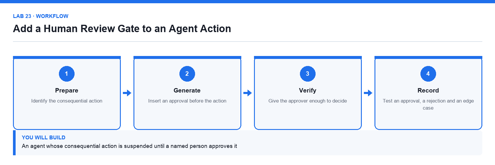

*Figure 23. Lab 23 workflow — the four stages and the artifact produced.*

**Before you begin**

- Open the lab folder labs/lab-23-add-a-human-review-gate-to-an-agent-action.
- Open the lab workbook and read the Scenario sheet.
- Have the printable instruction PDF open or to hand.
- Confirm the file Lumina-Living-Lab-23.xlsx is present — Boundary-of-agency and approval-test workbook.

**Primary prompt**

> Review this proposed action and summarise for the approver: what is being requested, the amount, the vendor, which policy rule applies and what your recommendation is. Present it as a decision, not as a completed action.

**Detailed procedure**

1. **Identify the consequential action**  
   Decide which single step in the process would be expensive or embarrassing to get wrong. That is the step that needs the gate.
2. **Rank the controls honestly**  
   A control the model cannot reach beats a rule you asked it to follow, and neither is the same as a name someone typed into a text box.
3. **Insert an approval before the action**  
   In the agent flow, place a Start and wait for an approval action before the step that has real effect.
4. **Send the approval to Microsoft Teams**  
   Route the approval to Teams so the approver receives it where they work and the decision is recorded against them.
5. **Give the approver enough to decide**  
   Include the request, the amount, the applicable rule and the recommendation, so approving does not require a separate investigation.
6. **Write an audit row regardless of the outcome**  
   Log every request, approved or rejected, so the record does not depend on the decision that was made.
7. **Test an approval, a rejection and an edge case**  
   Include a case the agent would plausibly get wrong, and confirm the gate stops it even when the agent's reasoning looked sound.

**Acceptance test**

The consequential action never completes without a recorded approval, a rejection stops it cleanly, and an audit row exists for every request regardless of outcome.

**Evidence to retain**

- Approval and rejection run histories, the Teams approval cards and the audit log rows.
- Your completed workbook, including the Prompt_Log and Evidence_Register sheets.
- A credential-safe screenshot — never capture passwords or personal data.

---

### Lab 24 — Test, Secure and Troubleshoot the Solution

Alignment: K5 · A6,A8.  Level: Advanced.  Apps: Power Automate, Copilot Studio, run history.

Objective: Verify behaviour across platforms and diagnose the technical issues an integration reveals.

Goal: The learner runs a structured test pass over the flows and agents built during the course, deliberately triggers failures, reads the run history to diagnose each one, and records the cause and the fix.

**What you will build**

A completed test log and an issue register with a diagnosed cause and fix for every failure

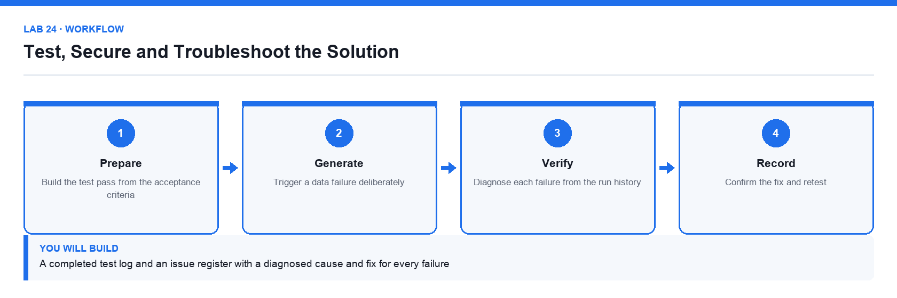

*Figure 24. Lab 24 workflow — the four stages and the artifact produced.*

**Before you begin**

- Open the lab folder labs/lab-24-test-secure-and-troubleshoot-the-solution.
- Open the lab workbook and read the Scenario sheet.
- Have the printable instruction PDF open or to hand.
- Confirm the file Lumina-Living-Lab-24.xlsx is present — Test log and issue register workbook.

**Primary prompt**

> This flow run failed. Read the error, explain in plain English what went wrong, tell me which step caused it and what I should change. Distinguish a data problem from a permission problem from a configuration problem.

**Detailed procedure**

1. **Build the test pass from the acceptance criteria**  
   Every lab in this course has a Test it criterion; those criteria are the test pass, not an afterthought.
2. **Test the happy path for each flow and agent**  
   Confirm the expected outcome and record the run identifier as evidence.
3. **Trigger a data failure deliberately**  
   Submit a malformed or empty value and observe how the flow behaves. An untested failure path is an unknown failure path.
4. **Trigger a permission failure deliberately**  
   Remove or break a connection and read the resulting error, so you recognise it when it happens in production.
5. **Diagnose each failure from the run history**  
   Open the failed step and read its inputs and outputs. The inputs usually show that the wrong data arrived, not that the action is broken.
6. **Classify the cause and record the fix**  
   Log each issue in Issue_Register as a data, permission or configuration problem, with the fix applied and the retest result.
7. **Confirm the fix and retest**  
   A fix is not complete until the failing case has been re-run and passes.

**Acceptance test**

Every flow and agent has a recorded happy-path result, each deliberately triggered failure is diagnosed with a cause and a fix, and every fix has a passing retest.

**Evidence to retain**

- Completed test log and issue register with run identifiers for each entry.
- Your completed workbook, including the Prompt_Log and Evidence_Register sheets.
- A credential-safe screenshot — never capture passwords or personal data.

---

### Lab 25 — Operate a Governed End-to-End Copilot Pipeline

Alignment: K5 · A7,A8.  Level: Capstone.  Apps: Microsoft 365 Copilot, Power Automate, Copilot Studio, Outlook, Teams, Excel.

Objective: Run the complete pipeline from request to verified output with governance evidence.

Goal: The learner runs one request end to end through the whole solution built during the week, produces the content, routes it through the automation and the human gate, and assembles the governance evidence pack.

**What you will build**

A complete pipeline run with content, automation, approval and a governance evidence pack

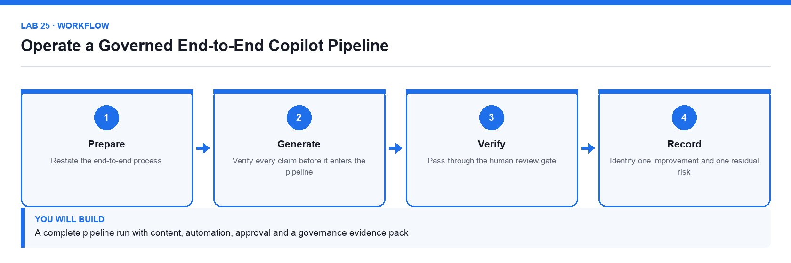

*Figure 25. Lab 25 workflow — the four stages and the artifact produced.*

**Before you begin**

- Open the lab folder labs/lab-25-operate-a-governed-end-to-end-copilot-pipeline.
- Open the lab workbook and read the Scenario sheet.
- Have the printable instruction PDF open or to hand.
- Confirm the file Lumina-Living-Lab-25.xlsx is present — End-to-end pipeline and governance evidence workbook.

**Primary prompt**

> Summarise this pipeline run for the governance record: what was requested, what Copilot generated, what was verified and by whom, which action required approval, who approved it and what the final outcome was. Flag anything that was released without a verification step.

**Detailed procedure**

1. **Restate the end-to-end process**  
   Map the full path from the original request to the released output, naming the system that handles each stage.
2. **Run the content stage**  
   Use Copilot to produce the required content, grounded in the approved source, exactly as in the Day 1 and Day 2 labs.
3. **Verify every claim before it enters the pipeline**  
   Unverified content that enters an automated pipeline gets distributed faster, not checked more.
4. **Run the automation stage**  
   Submit the request through the flow and confirm the log row and the notification both appear.
5. **Pass through the human review gate**  
   Confirm the consequential step suspends for approval and record the approver's decision.
6. **Assemble the governance evidence pack**  
   Collect the prompt log, the evidence register, the run identifiers, the approval record and the final output into one pack.
7. **Identify one improvement and one residual risk**  
   State what you would change before this ran unattended, and the risk that would remain even then.

**Acceptance test**

One request traverses content generation, verification, automation and human approval, and the evidence pack accounts for every stage with a named owner.

**Evidence to retain**

- The complete governance evidence pack, including run identifiers and the approval record.
- Your completed workbook, including the Prompt_Log and Evidence_Register sheets.
- A credential-safe screenshot — never capture passwords or personal data.

---

## Quick Prompt Reference

Every primary prompt used in the course, in lab order.

| Lab | Prompt |
|---|---|
| 01 | Summarise what Microsoft 365 Copilot can and cannot access on my behalf in this tenant. List the work data sources it may use, state that my existing permissions still apply, and give three limitations I should verify before trusting an answer. Do not invent features. |
| 02 | Draft a two-page project brief for the Sustainable Workspace campaign using the attached template and workbook. Include purpose, three measurable objectives, scope, milestones, budget, risks and open questions. Use only figures that appear in the workbook and mark anything uncertain as an open question. |
| 03 | Review the attached Responsible Copilot Use Policy. Identify unclear obligations, missing controls and any clause that a staff member could not act on. For each issue give the clause, the problem and a suggested rewrite. Do not add controls the organisation has not stated. |
| 04 | Create an eight-slide leadership presentation for the Sustainable Workspace campaign using the attached project brief and workbook. Build a decision-led story: context, customer need, campaign idea, target audience, timeline, budget, risks and approval request. Use concise slide titles that state the takeaway. Do not invent numbers. |
| 05 | Review this deck against the attached workbook. For each data slide, tell me which chart type communicates the message most honestly, what the axis and units should be, and what a presenter should say. Flag any chart whose visual impression overstates the underlying numbers. |
| 06 | In the Campaign_Data table add calculated columns for Margin, Margin_Percent, Conversion_Rate, Return_Rate and Target_Status. Use the thresholds in the Assumptions sheet, use structured references, and handle divide-by-zero safely. Explain each formula you add. |
| 07 | Analyse the Campaign_Data table. Give me a KPI summary, then break performance down by Region, Channel and Product. Identify the three largest drivers of the gap against Target_Revenue and list any records that look anomalous, with the reason. Cite the columns you used. |
| 08 | Using the historical Campaign_Data, build a six-month revenue forecast with base, downside and upside scenarios. Keep every assumption in the Assumptions sheet and reference it from the formulas. State the method you used and the conditions under which the forecast would not hold. |
| 09 | Summarise this email thread. List the decisions already made, the open questions, who owns each action and the dates committed. Flag anything where the thread contradicts itself. Do not infer agreement that was not stated. |
| 10 | From these meeting notes produce three things: a list of decisions made, a list of actions with an owner and a due date for each, and a list of unresolved questions. Quote the line that supports each decision. Do not create an action that nobody agreed to. |
| 11 | List the Power Platform environments I can use, and for each tell me its type, its region and whether it has a Dataverse database. Explain which one I should build a training flow in and why. |
| 12 | Describe the trigger and actions I need so that when someone submits a Microsoft Form, the person who submitted it receives a personalised confirmation email. Name the exact connector actions and explain why the response details step is needed. |
| 13 | I want every Microsoft Forms submission to be appended as a row in an Excel table stored in OneDrive. Tell me what the workbook must contain before the action will work, and what each field of the Add a row into a table action needs. |
| 14 | Explain how a Condition action works in Power Automate, what the If yes and If no branches do, and how I should test a flow that branches so I know both paths work. |
| 15 | Explain what happens to a Power Automate run when it reaches a Start and wait for an approval action, how long it can wait, and how I should handle the approved and rejected outcomes. |
| 16 | Help me scope an agent that answers staff questions about our procurement policy. List the questions it should answer, the questions it must refuse, the knowledge it needs, and the actions it should never take on its own. Ask me for anything you need to know. |
| 17 | You are the Lumina Living procurement assistant. Answer staff questions using only the approved procurement policy. Cite the section you used. If the answer is not in the policy, say so and tell the person who to contact. Never quote a price or recommend a vendor that is not in the policy. |
| 18 | Look up the vendor the user names in the ApprovedVendors list and report the vendor's status and category. If the vendor is not on the list, say it is not an approved vendor. Do not guess a status and do not use any other source. |
| 19 | You coordinate staff requests. If the request is about procurement policy or vendors, hand it to the Procurement Assistant. If it is about anything else, say it is out of scope and name the team to contact. Always tell the user which specialist answered. |
| 20 | Summarise what changes when an agent is published to Teams: who can reach it, which version they get, what happens to my unpublished edits, and how I roll back a bad release. |
| 21 | Explain how the When an HTTP request is received trigger works in Power Automate: where the URL comes from, why a JSON schema is needed, and how the Response action returns data to the caller. |
| 22 | Answer only from the attached course brochures. Quote the course code and the brochure section you used for every answer. If the brochures do not contain the answer, say that you do not have that information. Never estimate a price or a date. |
| 23 | Review this proposed action and summarise for the approver: what is being requested, the amount, the vendor, which policy rule applies and what your recommendation is. Present it as a decision, not as a completed action. |
| 24 | This flow run failed. Read the error, explain in plain English what went wrong, tell me which step caused it and what I should change. Distinguish a data problem from a permission problem from a configuration problem. |
| 25 | Summarise this pipeline run for the governance record: what was requested, what Copilot generated, what was verified and by whom, which action required approval, who approved it and what the final outcome was. Flag anything that was released without a verification step. |

## Assessment

The course is assessed by two instruments, both open book. You may use this guide, the slide deck and your completed lab files.

- Written Assessment (WA) — Short-Answer Questions (SAQ), 1 hour, open book.
- Practical Performance (PP) — hands-on Copilot and Power Platform tasks, 1 hour, open book.
- A minimum of 75% attendance is required to be eligible for assessment and funding.
- Remember to take the Assessment digital attendance (TRAQOM) and complete the TRAQOM survey.
- Submit your answers on the LMS at https://lms-tms.tertiaryinfotech.com.
- A re-assessment and appeal process is available if required.

**On assessment day**

1. **Complete the TRAQOM survey**  
   Scan the QR code shown on the LMS.
2. **Take the assessment digital attendance**  
   Scan the SSG QR code the trainer displays.
3. **Sit the Written Assessment (SAQ)**  
   One hour, open book, individual work.
4. **Sit the Practical Performance (PP)**  
   One hour, open book, individual work.
5. **Submit your answers on the LMS**  
   Check that every question has been answered.
6. **Sign the Assessment Summary Record**  
   Confirm your result has been recorded.

## Support

- Course portal: https://lms-tms.tertiaryinfotech.com
- Course page: https://www.tertiarycourses.com.sg/wsq-copilot-for-power-automate.html
- Provider: Tertiary Infotech Academy Pte Ltd (UEN: 201200696W)

---

*Microsoft Copilot for Content Creation and Task Automation · TGS-2024042588 · Version v1.0 · © 2026 Tertiary Infotech Academy Pte Ltd*