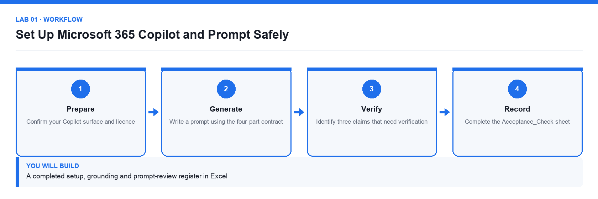

# Lab 01: Set Up Microsoft 365 Copilot and Prompt Safely

**Topic 01** · **Day 1** · **Foundation** · **Microsoft 365 Copilot Chat, Excel** · **K1 · A1**

## Goal

The learner confirms which Copilot surface they are licensed for, learns how grounding and permissions work, writes prompts using the four-part prompt contract, and records a review decision for every generated claim.

## Expected output

A completed setup, grounding and prompt-review register in Excel

*Figure. Lab 01 workflow — the four stages and the artifact produced.*

## Files

- `Lumina-Living-Lab-01.xlsx` — Setup, prompt-log and evidence register workbook
- `LAB-01-Instructions.pdf` — printable detailed guide
- `LAB-01-Workflow.png` — the workflow diagram above

## Primary prompt

> Summarise what Microsoft 365 Copilot can and cannot access on my behalf in this tenant. List the work data sources it may use, state that my existing permissions still apply, and give three limitations I should verify before trusting an answer. Do not invent features.

## Procedure

1. **Confirm your Copilot surface and licence**

   Open Microsoft 365 Copilot Chat and note whether the toggle shows Web or Work. Record the surface name in the Setup sheet, because grounding differs between them.

2. **Establish how grounding works**

   Ask Copilot the primary prompt. Copilot combines your prompt with permitted work context; it can never show you a file you could not already open yourself.

3. **Write a prompt using the four-part contract**

   Every prompt states the Goal, the Context, the Source and the Expectation. Record each of the four parts in the Prompt_Log sheet.

4. **Re-run the prompt with an explicit source**

   Attach or reference a specific file, then compare the grounded answer with the ungrounded one and note the difference.

5. **Identify three claims that need verification**

   Copy each claim into the Evidence_Register and record where it would be checked.

6. **Record a review decision for every claim**

   Mark each claim Verified, Corrected or Rejected. A claim that cannot be traced to a source is never released.

7. **Complete the Acceptance_Check sheet**

   Confirm the surface, the grounding source, three evidence-backed gaps and a verification status for every claim.

## Acceptance test

The register identifies the active Copilot surface, the grounding source, three evidence-backed gaps, and a verification status for every claim.

## Evidence to retain

- Completed workbook with Prompt_Log and Evidence_Register, plus a credential-safe screenshot of the Copilot surface.

---

*Microsoft Copilot for Content Creation and Task Automation · TGS-2024042588 · Version v1.0 · © 2026 Tertiary Infotech Academy Pte Ltd*