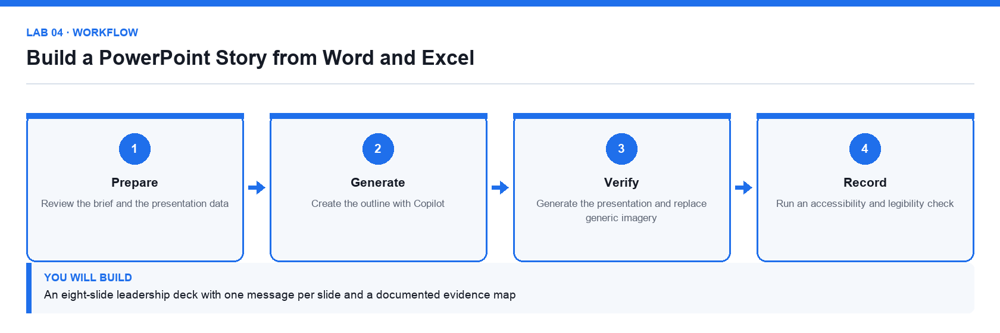

# Lab 04: Build a PowerPoint Story from Word and Excel

**Topic 01** · **Day 1** · **Intermediate** · **PowerPoint, Word, Excel, Copilot** · **K2 · A2**

## Goal

The learner generates a leadership deck from the approved brief and workbook, checks every claim against its source, and ends the deck with a specific decision request.

## Expected output

An eight-slide leadership deck with one message per slide and a documented evidence map

*Figure. Lab 04 workflow — the four stages and the artifact produced.*

## Files

- `Lumina-Living-Lab-04.xlsx` — Presentation data and evidence map workbook
- `Lumina-Living-Approved-Project-Brief.docx` — The approved brief from Lab 02
- `Lumina-Living-Blank-Leadership-Deck.pptx` — Branded blank 16:9 deck
- `LAB-04-Instructions.pdf` — printable detailed guide
- `LAB-04-Workflow.png` — the workflow diagram above

## Primary prompt

> Create an eight-slide leadership presentation for the Sustainable Workspace campaign using the attached project brief and workbook. Build a decision-led story: context, customer need, campaign idea, target audience, timeline, budget, risks and approval request. Use concise slide titles that state the takeaway. Do not invent numbers.

## Procedure

1. **Review the brief and the presentation data**

   Complete the Evidence_Map before generating slides so you know what each slide must prove.

2. **Open the supplied blank deck and confirm the 16:9 layout**

   Retain the Lumina Living theme and footer so the deck matches house branding.

3. **Create the outline with Copilot**

   Generate the outline first and review it before slides are built; fixing a story at outline stage is far cheaper.

4. **Check that every slide earns its place**

   Each slide must answer why it matters or what decision is needed, or it should be cut.

5. **Generate the presentation and replace generic imagery**

   Swap stock imagery for editable shapes or approved visuals; never use a decorative chart.

6. **Verify every number against the workbook**

   Record slide number, source sheet and cell range in Evidence_Map for each quantitative claim.

7. **Run an accessibility and legibility check**

   Check title size, colour contrast, alt text and reading order before the deck is shared.

## Acceptance test

The deck contains eight coherent slides, all quantitative claims trace to the workbook, and the final slide asks for a specific decision.

## Evidence to retain

- Completed deck, workbook with Evidence_Map, and a credential-safe screenshot.

---

*Microsoft Copilot for Content Creation and Task Automation · TGS-2024042588 · Version v1.0 · © 2026 Tertiary Infotech Academy Pte Ltd*