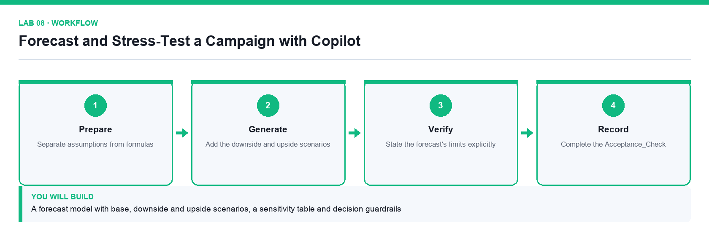

# Lab 08: Forecast and Stress-Test a Campaign with Copilot

**Topic 02** · **Day 2** · **Advanced** · **Excel, Copilot** · **K2 · A2**

## Goal

The learner builds base, downside and upside forecasts from the historical data, runs a sensitivity table across the key drivers, and records the guardrails that say when the forecast should not be trusted.

## Expected output

A forecast model with base, downside and upside scenarios, a sensitivity table and decision guardrails

*Figure. Lab 08 workflow — the four stages and the artifact produced.*

## Files

- `Lumina-Living-Lab-08.xlsx` — Historical data, assumptions and scenario workbook
- `LAB-08-Instructions.pdf` — printable detailed guide
- `LAB-08-Workflow.png` — the workflow diagram above

## Primary prompt

> Using the historical Campaign_Data, build a six-month revenue forecast with base, downside and upside scenarios. Keep every assumption in the Assumptions sheet and reference it from the formulas. State the method you used and the conditions under which the forecast would not hold.

## Procedure

1. **Separate assumptions from formulas**

   Every growth rate, conversion rate and cost factor lives in Assumptions and is referenced, never typed into a formula.

2. **Build the base case**

   Ask Copilot for the method as well as the numbers so the model can be explained to a reviewer.

3. **Add the downside and upside scenarios**

   Change only the assumption cells; if a scenario needs a formula change, the model is not built correctly.

4. **Build a sensitivity table across the two strongest drivers**

   Show how the outcome moves as each driver varies, so the reader sees the range rather than a single number.

5. **State the forecast's limits explicitly**

   Record the conditions under which this forecast should not be used for a decision.

6. **Record the decision guardrails**

   Define the thresholds at which the campaign would be paused, reviewed or escalated.

7. **Complete the Acceptance_Check**

   A reviewer must be able to change one assumption and see every scenario update.

## Acceptance test

Changing a single assumption cell updates all three scenarios and the sensitivity table, and the workbook states the conditions under which the forecast does not hold.

## Evidence to retain

- Forecast workbook with the scenario, sensitivity and guardrail sheets.

---

*Microsoft Copilot for Content Creation and Task Automation · TGS-2024042588 · Version v1.0 · © 2026 Tertiary Infotech Academy Pte Ltd*