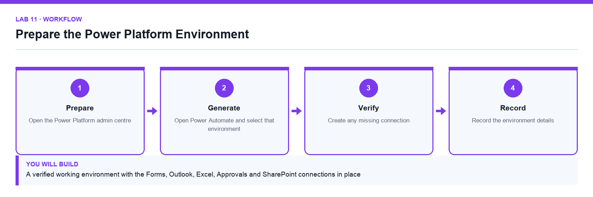

# Lab 11: Prepare the Power Platform Environment

**Topic 03** · **Day 3** · **Foundation** · **Power Platform admin centre, Power Automate** · **K3 · A1**

## Goal

The learner selects the correct Power Platform environment, confirms the connectors and connections the course needs, and records the environment details that every later lab depends on.

## Expected output

A verified working environment with the Forms, Outlook, Excel, Approvals and SharePoint connections in place

*Figure. Lab 11 workflow — the four stages and the artifact produced.*

## Files

- `Lumina-Living-Lab-11.xlsx` — Environment and connection verification workbook
- `LAB-11-Instructions.pdf` — printable detailed guide
- `LAB-11-Workflow.png` — the workflow diagram above

## Primary prompt

> List the Power Platform environments I can use, and for each tell me its type, its region and whether it has a Dataverse database. Explain which one I should build a training flow in and why.

## Procedure

1. **Open the Power Platform admin centre**

   Go to admin.powerplatform.microsoft.com and sign in with the course account. The environment is the container that holds every flow, agent and connection you create.

2. **Identify the environment you will use**

   Note its name, type and region in the Environment sheet. Building in the wrong environment is the single most common cause of a lab that cannot be found later.

3. **Open Power Automate and select that environment**

   Go to make.powerautomate.com and set the environment selector in the top-right corner. Check it before every lab.

4. **Review the existing connections**

   Under Connections, confirm which of Microsoft Forms, Office 365 Outlook, Excel Online (Business), Approvals and SharePoint are already connected.

5. **Create any missing connection**

   Add a connection for each missing connector and sign in with the course account when prompted.

6. **Confirm your mailbox is reachable**

   Send yourself a test message so you know the Outlook connection works before a flow depends on it.

7. **Record the environment details**

   Complete the Environment sheet with the environment name, region and the connections verified, and note the date.

## Acceptance test

The environment selector shows the recorded environment, and every connector needed by the course appears under Connections with a working status.

## Evidence to retain

- Completed environment workbook and a credential-safe screenshot of the connections list.

---

*Microsoft Copilot for Content Creation and Task Automation · TGS-2024042588 · Version v1.0 · © 2026 Tertiary Infotech Academy Pte Ltd*