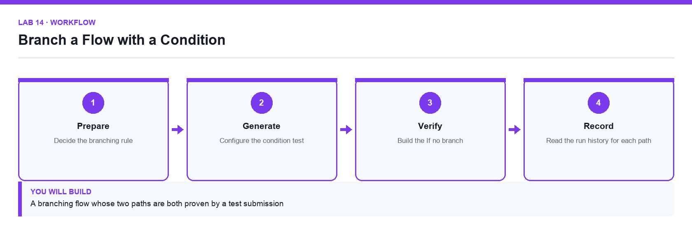

# Lab 14: Branch a Flow with a Condition

**Topic 03** · **Day 3** · **Intermediate** · **Power Automate, Microsoft Forms, Outlook** · **K3 · A3**

## Goal

The learner adds a condition so that enquiries are handled differently according to their content, sending an urgent notification down one branch and a standard acknowledgement down the other.

## Expected output

A branching flow whose two paths are both proven by a test submission

*Figure. Lab 14 workflow — the four stages and the artifact produced.*

## Files

- `Lumina-Living-Lab-14.xlsx` — Branch design and test-evidence workbook
- `LAB-14-Instructions.pdf` — printable detailed guide
- `LAB-14-Workflow.png` — the workflow diagram above

## Primary prompt

> Explain how a Condition action works in Power Automate, what the If yes and If no branches do, and how I should test a flow that branches so I know both paths work.

## Procedure

1. **Decide the branching rule**

   Define the business rule first: an enquiry mentioning a named urgent keyword is escalated, everything else receives the standard acknowledgement.

2. **Add a Condition action**

   Insert a Condition after Get response details. A condition evaluates to true or false and creates the If yes and If no branches.

3. **Configure the condition test**

   Set the left side from the Message dynamic value, choose the contains operator, and enter the keyword on the right side.

4. **Build the If yes branch**

   Add a Send an email (V2) action that notifies the team mailbox with the enquiry details and an Urgent subject line.

5. **Build the If no branch**

   Move the standard confirmation email into the If no branch so exactly one acknowledgement is sent per submission.

6. **Test both paths deliberately**

   Submit once with the keyword and once without. A branch that has never run is a branch you have not tested.

7. **Read the run history for each path**

   Open both runs and confirm which branch executed. Skipped actions appear greyed out, which is not the same as a failure.

## Acceptance test

Two submissions produce two successful runs that each take a different branch, and the run history shows the untaken branch as skipped rather than failed.

## Evidence to retain

- Run histories for both branches and the two resulting emails.

---

*Microsoft Copilot for Content Creation and Task Automation · TGS-2024042588 · Version v1.0 · © 2026 Tertiary Infotech Academy Pte Ltd*