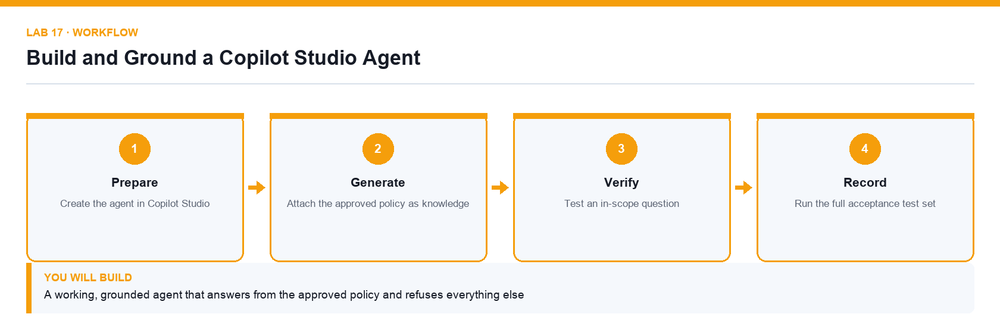

# Lab 17: Build and Ground a Copilot Studio Agent

**Topic 04** · **Day 4** · **Intermediate** · **Copilot Studio, SharePoint** · **K4 · A5**

## Goal

The learner creates an agent in Copilot Studio, writes instructions that define its role and limits, attaches the approved policy as knowledge, removes the open-web source and tests that it cites and refuses correctly.

## Expected output

A working, grounded agent that answers from the approved policy and refuses everything else

*Figure. Lab 17 workflow — the four stages and the artifact produced.*

## Files

- `Lumina-Living-Lab-17.xlsx` — Agent build and test-results workbook
- `Procurement-Policy.docx` — The approved procurement policy
- `LAB-17-Instructions.pdf` — printable detailed guide
- `LAB-17-Workflow.png` — the workflow diagram above

## Primary prompt

> You are the Lumina Living procurement assistant. Answer staff questions using only the approved procurement policy. Cite the section you used. If the answer is not in the policy, say so and tell the person who to contact. Never quote a price or recommend a vendor that is not in the policy.

## Procedure

1. **Create the agent in Copilot Studio**

   At copilotstudio.microsoft.com choose Create, then New agent, and name it Procurement Assistant. Confirm you are in the course environment.

2. **Write the instructions**

   Paste the primary prompt into Instructions. Instructions shape behaviour but are not enforced, so keep them specific and testable.

3. **Attach the approved policy as knowledge**

   Under Knowledge, add the supplied procurement policy. Only an attached source can be cited.

4. **Remove the Search all websites source**

   This source is on by default. Remove it before the first test or the agent will answer procurement questions from the open web.

5. **Test an in-scope question**

   Ask a question the policy answers and confirm the reply cites the policy section rather than paraphrasing from memory.

6. **Test an out-of-scope question**

   Ask something the policy does not cover and confirm the agent refuses and redirects, rather than inventing an answer.

7. **Run the full acceptance test set**

   Work through the ten tests from Lab 16 and record the actual result against the expected one for each.

## Acceptance test

The agent cites the policy for in-scope questions, refuses and redirects for out-of-scope ones, and passes every acceptance test recorded in the workbook.

## Evidence to retain

- Agent test transcript, the completed test results and a credential-safe screenshot of the knowledge panel.

---

*Microsoft Copilot for Content Creation and Task Automation · TGS-2024042588 · Version v1.0 · © 2026 Tertiary Infotech Academy Pte Ltd*