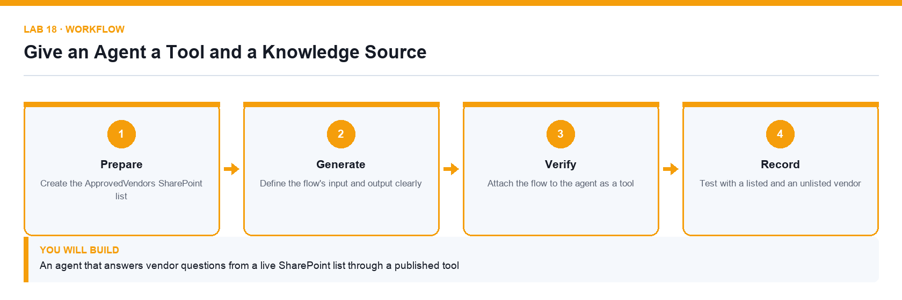

# Lab 18: Give an Agent a Tool and a Knowledge Source

**Topic 04** · **Day 4** · **Intermediate** · **Copilot Studio, SharePoint, Power Automate** · **K4 · A5**

## Goal

The learner creates a SharePoint list of approved vendors, publishes an agent flow that looks a vendor up, attaches it to the agent as a tool, and proves the agent calls it instead of guessing.

## Expected output

An agent that answers vendor questions from a live SharePoint list through a published tool

*Figure. Lab 18 workflow — the four stages and the artifact produced.*

## Files

- `Lumina-Living-Lab-18.xlsx` — Tool design and test workbook
- `Approved-Vendors.csv` — Vendor master data for the SharePoint list
- `LAB-18-Instructions.pdf` — printable detailed guide
- `LAB-18-Workflow.png` — the workflow diagram above

## Primary prompt

> Look up the vendor the user names in the ApprovedVendors list and report the vendor's status and category. If the vendor is not on the list, say it is not an approved vendor. Do not guess a status and do not use any other source.

## Procedure

1. **Create the ApprovedVendors SharePoint list**

   Import the supplied vendors.csv into a SharePoint list with columns for vendor name, category, status and review date.

2. **Build an agent flow that queries the list**

   In Copilot Studio create a flow that takes a vendor name as input, uses the SharePoint Get items action with a filter, and returns the matching status and category.

3. **Define the flow's input and output clearly**

   The tool's contract is what the agent understands. An ambiguous output field will be interpreted inconsistently.

4. **Publish the flow**

   An unpublished flow cannot be attached as a tool. Publish it before returning to the agent.

5. **Attach the flow to the agent as a tool**

   Under Tools, add the published flow and give it a description that says exactly when to use it.

6. **Write a tool description the model can act on**

   The description is how the agent decides whether to call the tool; a vague description produces a tool that is never called or always called.

7. **Test with a listed and an unlisted vendor**

   Confirm the agent calls the tool and reports the real status, and that an unknown vendor is reported as not approved rather than invented.

## Acceptance test

The agent returns the correct live status for a listed vendor and reports an unlisted vendor as not approved, with the run history showing the tool was actually called.

## Evidence to retain

- Tool call shown in the run history, plus the test transcript for both cases.

---

*Microsoft Copilot for Content Creation and Task Automation · TGS-2024042588 · Version v1.0 · © 2026 Tertiary Infotech Academy Pte Ltd*