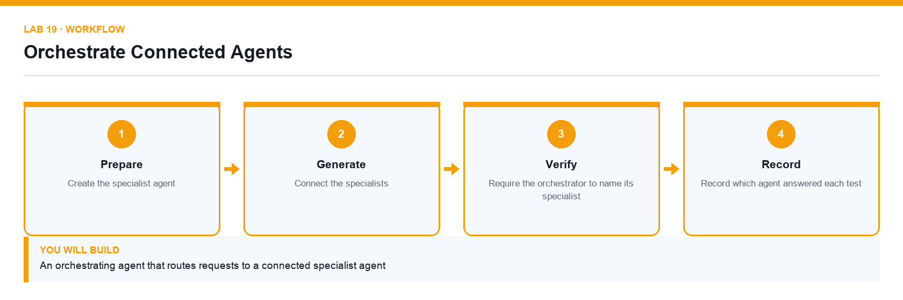

# Lab 19: Orchestrate Connected Agents

**Topic 04** · **Day 4** · **Advanced** · **Copilot Studio, connected agents** · **K4 · A5**

## Goal

The learner builds a second specialised agent and connects it to the first, so an orchestrating agent routes each request to the right specialist and reports which one answered.

## Expected output

An orchestrating agent that routes requests to a connected specialist agent

*Figure. Lab 19 workflow — the four stages and the artifact produced.*

## Files

- `Lumina-Living-Lab-19.xlsx` — Orchestration and routing-test workbook
- `LAB-19-Instructions.pdf` — printable detailed guide
- `LAB-19-Workflow.png` — the workflow diagram above

## Primary prompt

> You coordinate staff requests. If the request is about procurement policy or vendors, hand it to the Procurement Assistant. If it is about anything else, say it is out of scope and name the team to contact. Always tell the user which specialist answered.

## Procedure

1. **Create the specialist agent**

   Build a second narrow agent for a different domain, grounded only in its own knowledge source.

2. **Create the orchestrating agent**

   Create a third agent whose job is routing rather than answering, and paste the primary prompt into its instructions.

3. **Connect the specialists**

   Under Connected agents, add each specialist and describe precisely what it handles.

4. **Write routing rules that do not overlap**

   Two specialists whose descriptions overlap will be selected inconsistently; make the boundary explicit.

5. **Require the orchestrator to name its specialist**

   Attribution is what makes a wrong answer traceable to the agent that produced it.

6. **Test each route**

   Send one request per specialist plus one that belongs to neither, and confirm each is handled correctly.

7. **Record which agent answered each test**

   Complete the Routing_Test sheet with the request, the expected specialist and the one that actually answered.

## Acceptance test

Each test request reaches the correct specialist, the out-of-scope request is refused, and every reply names the agent that answered it.

## Evidence to retain

- Routing test results and transcripts showing the attribution for each answer.

---

*Microsoft Copilot for Content Creation and Task Automation · TGS-2024042588 · Version v1.0 · © 2026 Tertiary Infotech Academy Pte Ltd*