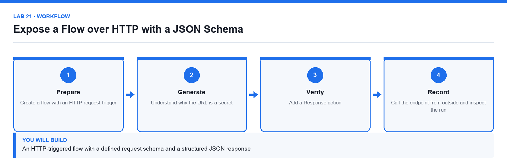

# Lab 21: Expose a Flow over HTTP with a JSON Schema

**Topic 05** · **Day 5** · **Intermediate** · **Power Automate, HTTP, JSON** · **K5 · A4**

## Goal

The learner builds a flow with an HTTP request trigger, defines the request body with a JSON schema, returns a structured response, and calls it from outside Power Automate to prove the integration works.

## Expected output

An HTTP-triggered flow with a defined request schema and a structured JSON response

*Figure. Lab 21 workflow — the four stages and the artifact produced.*

## Files

- `Lumina-Living-Lab-21.xlsx` — Endpoint contract and test-call workbook
- `Request-Schema.json` — Sample request body used to generate the schema
- `LAB-21-Instructions.pdf` — printable detailed guide
- `LAB-21-Workflow.png` — the workflow diagram above

## Primary prompt

> Explain how the When an HTTP request is received trigger works in Power Automate: where the URL comes from, why a JSON schema is needed, and how the Response action returns data to the caller.

## Procedure

1. **Create a flow with an HTTP request trigger**

   Create an instant cloud flow and choose When an HTTP request is received. The trigger generates its own URL, which is the endpoint external systems call.

2. **Define the request body JSON schema**

   Use Generate from sample and paste a representative request. The schema is the contract that tells the flow what fields to expect and makes them available as dynamic content.

3. **Understand why the URL is a secret**

   The generated URL contains a signature that authorises the call. Anyone who has the URL can trigger the flow, so treat it like a credential.

4. **Add the processing steps**

   Use the parsed fields from the trigger to do the work — for this lab, validate the request and look up a result.

5. **Add a Response action**

   Return a status code and a JSON body. Without a Response action the caller receives only an acknowledgement, not a result.

6. **Save and copy the endpoint URL**

   The URL is only generated once the flow is saved. Record it in the workbook rather than in a shared chat.

7. **Call the endpoint from outside and inspect the run**

   Send a test request with the documented body, then confirm the run history shows the received payload and the returned response.

## Acceptance test

An external call with a valid body returns the expected JSON response, and the run history shows the parsed fields exactly as the schema defined them.

## Evidence to retain

- The request and response pair, plus the run history showing the received payload.

---

*Microsoft Copilot for Content Creation and Task Automation · TGS-2024042588 · Version v1.0 · © 2026 Tertiary Infotech Academy Pte Ltd*