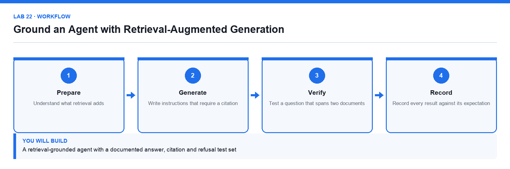

# Lab 22: Ground an Agent with Retrieval-Augmented Generation

**Topic 05** · **Day 5** · **Advanced** · **Copilot Studio, Knowledge, SharePoint** · **K5 · A5**

## Goal

The learner grounds an agent in a document set, tests it with questions the documents answer and questions they do not, and probes deliberately for invention to confirm the refusal behaviour holds.

## Expected output

A retrieval-grounded agent with a documented answer, citation and refusal test set

*Figure. Lab 22 workflow — the four stages and the artifact produced.*

## Files

- `Lumina-Living-Lab-22.xlsx` — RAG test-design and results workbook
- `Course-Brochures.docx` — The brochure pack used as the knowledge source
- `LAB-22-Instructions.pdf` — printable detailed guide
- `LAB-22-Workflow.png` — the workflow diagram above

## Primary prompt

> Answer only from the attached course brochures. Quote the course code and the brochure section you used for every answer. If the brochures do not contain the answer, say that you do not have that information. Never estimate a price or a date.

## Procedure

1. **Understand what retrieval adds**

   Retrieval finds relevant passages and gives them to the model with the question, so the answer comes from the documents rather than model memory.

2. **Upload the supplied document set as knowledge**

   Add the brochure pack under Knowledge. Retrieval can only find what has been ingested.

3. **Write instructions that require a citation**

   Paste the primary prompt. Requiring a citation is what makes a wrong answer visible.

4. **Test a question the documents clearly answer**

   Confirm the reply is correct and cites the right document and section.

5. **Test a question that spans two documents**

   Confirm the agent combines the sources correctly and cites both rather than silently picking one.

6. **Probe deliberately for invention**

   Ask about a course that does not exist and about a price the brochures never state. Both must produce a refusal, not a plausible answer.

7. **Record every result against its expectation**

   Complete the RAG_Test sheet with the question, the expected behaviour, the actual answer and the citation given.

## Acceptance test

Every in-scope question is answered with a correct citation, and questions about non-existent courses or unstated prices produce an explicit refusal rather than an invented answer.

## Evidence to retain

- Completed RAG test sheet with transcripts and citations for each case.

---

*Microsoft Copilot for Content Creation and Task Automation · TGS-2024042588 · Version v1.0 · © 2026 Tertiary Infotech Academy Pte Ltd*